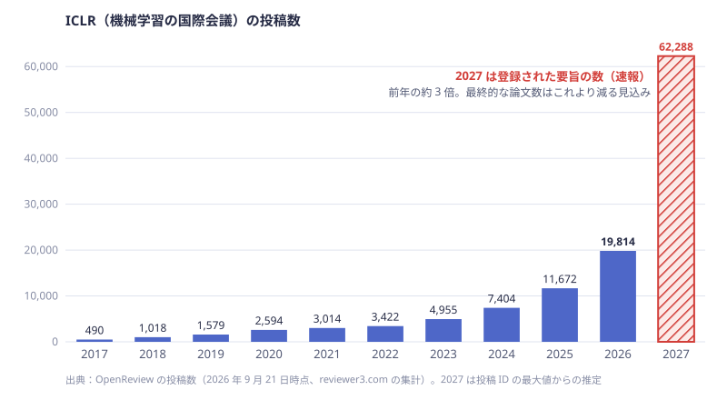
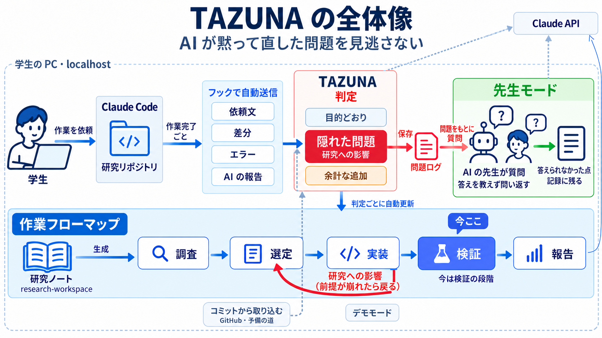
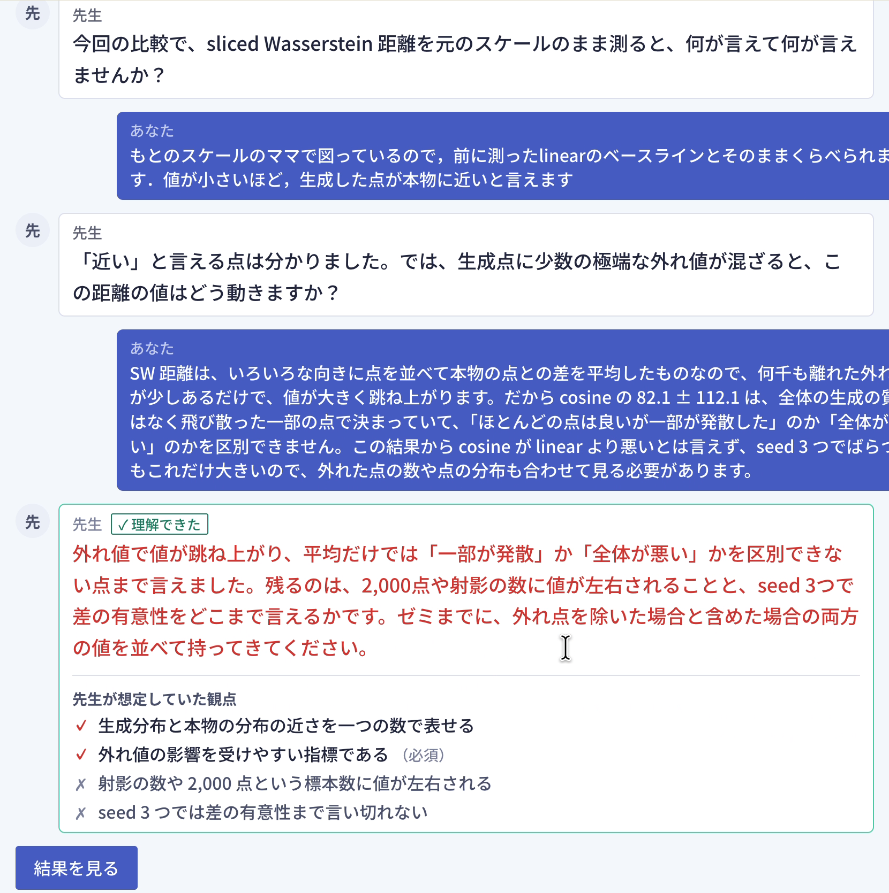
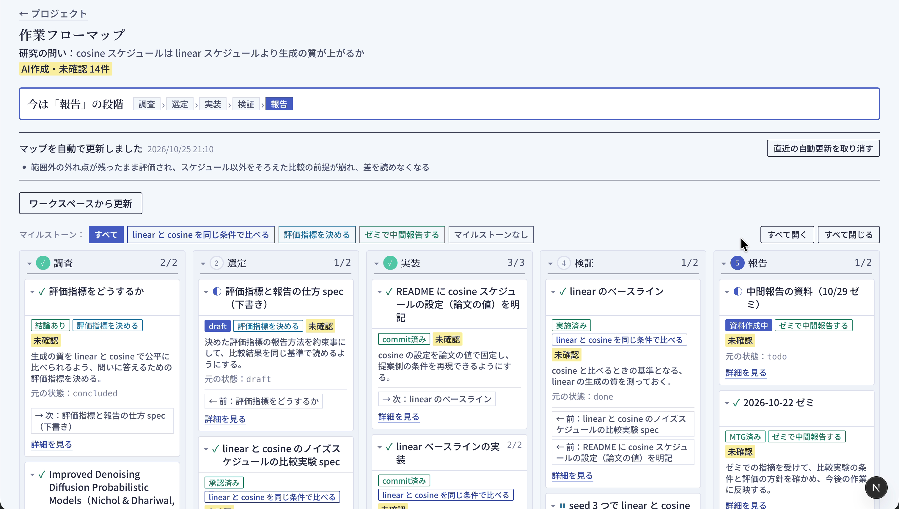

# TAZUNA

**AI が研究のコードを書く時代に、AI が黙って解決した問題を見逃さず、研究と実装の理解を取り戻す Web アプリ。**

[](https://youtu.be/3dEagmwuUeM)

### デモ動画（5分35秒）

本物の Claude API と、デモ用の研究リポジトリ（拡散モデルのノイズスケジュールの比較）で、プロジェクトを作るところから通しで動かしています。

- [0:08](https://youtu.be/3dEagmwuUeM?t=8) プロジェクトを作る：研究の目的を「問い・手法・評価」で書く
- [0:21](https://youtu.be/3dEagmwuUeM?t=21) 作業フローマップを作る：研究の記録から、工程ごとのタスクを1枚に
- [0:41](https://youtu.be/3dEagmwuUeM?t=41) いつもどおり Claude Code に頼む（ここは早送り）
- [0:56](https://youtu.be/3dEagmwuUeM?t=56) 作業が終わると、フックで TAZUNA に届いて自動で判定
- [1:06](https://youtu.be/3dEagmwuUeM?t=66) 判定結果：AI が警告を残したまま比べていた「隠れた問題」と、その研究への影響
- [2:02](https://youtu.be/3dEagmwuUeM?t=122) 先生モード：「AIがやったのでわかりません」には、答えを教えずに問い返す
- [4:06](https://youtu.be/3dEagmwuUeM?t=246) 講評と「答えられなかった点」
- [4:22](https://youtu.be/3dEagmwuUeM?t=262) 問題ログ
- [4:46](https://youtu.be/3dEagmwuUeM?t=286) 作業フローマップの自動更新
- [5:15](https://youtu.be/3dEagmwuUeM?t=315) 設定：機能ごとに使う AI のモデルを選び、使用量と料金の目安を見る

## 製品概要

### 背景(製品開発のきっかけ、課題等）

**AI を使った研究は、世界中で急に加速しています。** 機械学習の国際会議 ICLR の投稿数は、2017 年の 490 件から 2026 年の 19,814 件へと 40 倍に増えました。さらに ICLR 2027 では、登録された要旨が **62,288 件** と、前年の約 3 倍に跳ね上がりました（最終的な論文数はこれより減る見込みですが、それでも前年を大きく上回ります）。ICLR 2027 は、1 人が共著者になれる論文を 20 本までに制限し、論文に AI の使い方の記載（AI use statement）を求めるようになりました。AI で研究を速く回すことが当たり前になり、学会の側も対応を迫られています。



出典：

- 投稿数（2017〜2027 年）：[ICLR Went From 490 Submissions to 62,000 in Ten Years（reviewer3.com、2026 年 9 月 21 日）](https://reviewer3.com/evidence/iclr-submissions-2027)。OpenReview の投稿数を集計したもの。2027 年は投稿 ID の最大値から推定した、登録された要旨の数。同じ記事によると、2026 年に ICLR が発表した有効な投稿は 19,525 件
- 投稿数（2018〜2026 年の照合）：[ICLR statistics（Paper Copilot）](https://papercopilot.com/statistics/iclr-statistics/)
- 締め切り前の要旨の数：[AI conference ICLR is drowning in abstracts（The Decoder、2026 年 9 月 19 日）](https://the-decoder.com/ai-conference-iclr-is-drowning-in-abstracts-with-roughly-50000-submissions-before-the-deadline/)
- 共著の上限（20 本）と AI の使い方の記載：[ICLR 2027 Author Guidelines](https://iclr.cc/Conferences/2027/AuthorGuidelines)

情報系の研究室では、Claude Code や Codex などの生成 AI にコードを書かせながら研究を進めるのが当たり前になりました。私たち自身もそうしています。研究は速く進むようになりましたが、次のような困りごとが起きています。

- **理解が追いつかない。** 研究の進み方が速すぎて、自分の理解がボトルネックになる。自分が意図していない実装になっていても気づかない。先生に「ここどうなっている？」と聞かれて、分かっていないことが露呈する
- **AI が黙って直す。** エラーが出ると、AI は頼んでいない変更（データの正規化、外れ値の除外、値に上限を付けるなど）で黙って解決し、「動きました」と報告する。コードは動くが、**研究の前提や比べ方が変わっている** ことがある

今の AI コーディングツールは「速く作る」ためのアクセルです。研究には、人間が **舵を握り続ける** ためのハンドルとブレーキが要ると考えました。

### 製品説明（具体的な製品の説明）

TAZUNA は、AI の変更を **研究の目的** と照らし合わせ、AI が黙って対処した問題を見つけ、あなたが自分の言葉で説明できるかを確かめる Web アプリです。



1. **プロジェクトを作る。** 研究のリポジトリ（GitHub）を選び、研究の目的を **問い・手法・評価** の3つで書く
2. **いつもどおり Claude Code に頼む。** 研究のリポジトリに Claude Code のフックを入れておくと、作業が終わるたびに、依頼文・変更の差分・作業中に実際に起きたエラー・AI の最終報告が、手元の TAZUNA に自動で届く。コミットしなくてよい
3. **判定を見る。** AI が変更を **目的どおり／隠れた問題／余計な追加** に分ける。隠れた問題には、AI が避けたエラー、その対処、そして **研究への影響**（その対処で研究の条件が崩れていないか）が付く。関係するコードの差分もその場で見られる

   

4. **先生モードで確かめる。** AI が先生役になり、保存した問題や研究手法について1問ずつ質問する。答えが足りないと、答えを教えずに問い返す。最後に講評と「答えられなかった点」が残り、ゼミの前に見直せる

   

5. **作業フローマップで全体を見る。** 研究の工程（調査・選定・実装・検証・報告）ごとのタスクと目的を1枚にまとめ、変更を取り込むたびに更新する。隠れた問題が研究の前提に影響するときは、前の工程へ戻る矢印を引く

   

アプリの中の「使い方」のページ（`/guide`）で、実際の画面を見ながら流れを確かめられます。

### 特長

#### 1. 意図とのずれを「隠れた問題」のサインとして拾う

AI が頼んだことと違う実装をしたとき、そこには AI が黙って解決した問題がある、と捉えます。ずれを「AI のミス」として消すのではなく、**自分が知らなかった問題（エラーとその対処）を見つける手がかり** として保存します。たまった問題は、先生に聞かれたときの答えになります。

#### 2. 実装だけでなく「研究への影響」まで見る

研究の目的（問い・手法・評価）と照らし合わせるので、「データを正規化した」「β に上限を付けた」といった対処が、**評価の条件（元のスケールで測る、変えるのはスケジュールだけ）を崩していないか** まで指摘します。汎用のコードレビューにはない、研究ならではの観点です。

#### 3. いつもの作業を止めずに、自動で届く

Claude Code のフック（`UserPromptSubmit` と `Stop`）で、依頼文・差分・実際に起きたエラー・AI の最終報告を取り込みます。学生は普段どおり AI に頼むだけで、作業が終わると画面の右下に知らせが出ます。エラーは会話記録から実際のものを取り、AI の推測とは区別します。

#### 4. 答えを教えない先生モード

先生役の AI は、質問ごとに想定解答の「観点」を用意し、言えた観点に印を付けます。足りないところは答えを言わずに問い返し、自分で気づけるように導きます。

#### 5. 研究の工程の中で、今どこにいるかが分かる

研究の記録（壁打ち・論文メモ・spec・ゼミの記録・実験記録）と実装リポジトリから、研究の工程ごとのタスクを AI が1枚のマップにします。AI の変更を取り込むたびに自動で更新し、記録に無い実装や、研究の前提に戻って考え直すべきところを示します。目の前の実装に追われて、研究の問いを見失わないためです。

### 解決出来ること

- AI が黙って直した問題に気づける。気づかないまま実験を進め、あとで結果が使えないと分かる、という手戻りを防ぐ
- 自分の研究のコードで何が起きたかを、自分の言葉で説明できるようになる。ゼミや先生との打ち合わせで「分かっていない」ことが露呈しにくくなる
- AI の頼んでいない追加（余計な機能やオプション）を知らせ、把握しないまま増えていく認知負荷を減らす

### 今後の展望

- Codex など、Claude Code 以外の AI ツールからの自動取り込み
- 公開した Web アプリとしての提供（データベースと認証を用意し、研究室のメンバーで使えるようにする）
- 問題ログのキーワード検索と、見返し方の工夫
- 研究の問いと今いる工程を見失わないための機能（作業フローマップの発展）
- PR 単位での取り込み

### 注力したこと（こだわり等）

* **研究の目的と照らす判定。** データの問題（欠損値・外れ値・スケールなど）への対処は、頼まれていなければエラーが出ていなくても隠れた問題として扱う。AI の最終報告は自己申告なので、差分と食い違えば差分を優先する
* **実際に起きたエラーを使う。** フックで会話記録から失敗したコマンドや出力に出たエラーを取り出し、推測のエラーと区別して見せる
* **先生の聞き方。** 手法は否定しても人格は否定しない口調で、答えを言わずに問い返す。観点による採点で「理解できた」の基準をはっきりさせる
* **安全に扱う。** API キーはサーバー側だけで使い、画面にも保存先にも値を出さない。フックの受け取り口は localhost からだけ受け付け、合言葉で守る。研究のコードに含まれる秘密らしき値はフックの段階で伏せ字にする
* **デモが止まらない工夫。** 外部サービスを呼ばずに通しで動かせるデモモードと、GitHub のコミットから取り込む予備の道を用意した
* **費用の見える化。** 機能ごとに Claude のモデル（Haiku / Sonnet / Opus）とエフォートを選べ、使ったトークン数と料金の目安を記録する
* **読みやすい画面。** 論文の査読のような書式と、指摘だけに使う赤ペンの色で、どこが問題かが一目で分かるようにした。字は Noto Sans JP で大きめにそろえた

## 開発技術

### 活用した技術

#### API・データ

* Claude API（Anthropic）：ずれの判定、先生モード、作業フローマップの作成。標準は Claude Haiku 5.5 で、設定画面から Sonnet 5.5 / Opus 5.5 に切り替えられる。構造化出力（`messages.parse` と zod のスキーマ）で結果を受け取る
* GitHub REST API：リポジトリの一覧、コミット、差分、research-workspace の読み取り
* Claude Code のフック（`UserPromptSubmit`、`Stop`）：依頼文・差分・エラー・AI の最終報告の取り込み

#### フレームワーク・ライブラリ・モジュール

* Next.js 15（App Router、Route Handlers）、React 19、TypeScript（Node.js 18 以上）
* Tailwind CSS 4
* Anthropic TypeScript SDK（`@anthropic-ai/sdk`）、zod 4
* Vitest（web 595 件）、Node.js のテストランナー（フック 34 件）
* データの保存はブラウザの localStorage（差分は IndexedDB）。データベースは使わない

#### デバイス

* PC（Web ブラウザ）。アプリは学生の PC の localhost で動かす

### 独自技術

#### ハッカソンで開発した独自機能・技術

すべて Hack Day（10/24〜10/25）に開発しました。設計は [docs/design.md](docs/design.md) にまとめています。

* **Claude Code のフックからの自動取り込み**（[hook/research-check.mjs](hook/research-check.mjs)、[#6](https://github.com/jphacks/ng_2614/pull/6)）：依存パッケージなしの Node.js スクリプト。作業の前後の差分（未コミットのままでよい）と、会話記録から実際に起きたエラーと AI の最終報告を取り出し、秘密らしき値を伏せてから手元のアプリに送る
* **研究の目的と照らすずれの判定**（[web/src/lib/llm/review.ts](web/src/lib/llm/review.ts)、[#11](https://github.com/jphacks/ng_2614/pull/11)）：目的どおり／隠れた問題／余計な追加への分類と、研究への影響の判定
* **問い返し型の先生モードと観点による採点**（[web/src/lib/llm/teacher.ts](web/src/lib/llm/teacher.ts)、[#12](https://github.com/jphacks/ng_2614/pull/12)、[#15](https://github.com/jphacks/ng_2614/pull/15)）
* **作業フローマップ**（[web/src/lib/llm/map.ts](web/src/lib/llm/map.ts)、[#16](https://github.com/jphacks/ng_2614/pull/16)、[#18](https://github.com/jphacks/ng_2614/pull/18)）：research-workspace と実装リポジトリから研究の工程を1枚にし、判定のたびに更新する
* **AI のモデル・エフォートの切り替えと使用量の記録**（[#19](https://github.com/jphacks/ng_2614/pull/19)）、**画面からの接続の設定**（[#23](https://github.com/jphacks/ng_2614/pull/23)）
* **判定結果の要約と次の一手**（[#42](https://github.com/jphacks/ng_2614/pull/42)）：隠れた問題と研究への影響の数を1行で見せ、「まとめて保存して先生モードへ」で迷わず次に進める。まだ開いていない判定には印を付ける
* **デモモードとピッチ用の入口**（[web/src/lib/demo/](web/src/lib/demo)、[#9](https://github.com/jphacks/ng_2614/pull/9)、[#44](https://github.com/jphacks/ng_2614/pull/44)、[#46](https://github.com/jphacks/ng_2614/pull/46)）：API を呼ばずに通しで動かせるデモと、資料のリンクから開くとフックの知らせが届くところから始まる入口（`/pitch`）
* **使い方ガイド**（[web/src/app/guide/page.tsx](web/src/app/guide/page.tsx)、[#24](https://github.com/jphacks/ng_2614/pull/24)、[#58](https://github.com/jphacks/ng_2614/pull/58)）：アプリの流れを、本物の API で動かした画面で紹介する

## 動かし方

手元の PC で動かします（macOS で確認しています）。Node.js 18 以上と git が要ります。

```bash
git clone https://github.com/jphacks/ng_2614.git
cd ng_2614/web
npm install
cp .env.example .env.local   # ANTHROPIC_API_KEY と GITHUB_TOKEN を入れる（画面の「設定 → 接続」から入れてもよい）
npm run dev                  # http://localhost:3000 を開く
```

- **キーなしで試す**：画面右上の「デモモード」を入れると、Claude API と GitHub を呼ばずに、デモ用のデータで一通り動かせます
- **Claude Code のフック**：研究のリポジトリの `.claude/settings.local.json` に [hook/research-check.mjs](hook/research-check.mjs) を登録すると、Claude Code に頼んだ作業が自動で届きます。手順は [hook/README.md](hook/README.md) にあります
- **テスト**：`web/` で `npm test`、`hook/` で `npm test`
