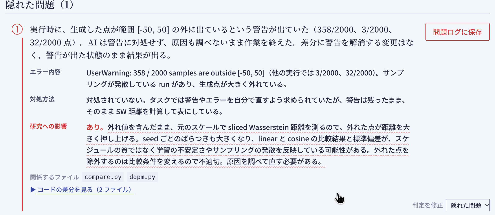

# TAZUNA

<!-- TODO: デモ動画を撮ったら、下のリンク先（YouTube の URL）と画像を差し替える -->

**AI が研究のコードを書く時代に、AI が黙って解決した問題を見逃さず、研究と実装の理解を取り戻す Web アプリ。**

## 製品概要

### 背景(製品開発のきっかけ、課題等）

情報系の研究室では、Claude Code や Codex などの生成 AI にコードを書かせながら研究を進めるのが当たり前になりました。私たち自身もそうしています。研究は速く進むようになりましたが、次のような困りごとが起きています。

- **理解が追いつかない。** 研究の進み方が速すぎて、自分の理解がボトルネックになる。自分が意図していない実装になっていても気づかない。先生に「ここどうなっている？」と聞かれて、分かっていないことが露呈する
- **AI が黙って直す。** エラーが出ると、AI は頼んでいない変更（データの正規化、外れ値の除外、値に上限を付けるなど）で黙って解決し、「動きました」と報告する。コードは動くが、**研究の前提や比べ方が変わっている** ことがある

今の AI コーディングツールは「速く作る」ためのアクセルです。研究には、人間が **舵を握り続ける** ためのハンドルとブレーキが要ると考えました。

### 製品説明（具体的な製品の説明）

TAZUNA は、AI の変更を **研究の目的** と照らし合わせ、AI が黙って対処した問題を見つけ、あなたが自分の言葉で説明できるかを確かめる Web アプリです。

1. **プロジェクトを作る。** 研究のリポジトリ（GitHub）を選び、研究の目的を **問い・手法・評価** の3つで書く
2. **いつもどおり Claude Code に頼む。** 研究のリポジトリに Claude Code のフックを入れておくと、作業が終わるたびに、依頼文・変更の差分・作業中に実際に起きたエラー・AI の最終報告が、手元の TAZUNA に自動で届く。コミットしなくてよい
3. **判定を見る。** AI が変更を **目的どおり／隠れた問題／余計な追加** に分ける。隠れた問題には、AI が避けたエラー、その対処、そして **研究への影響**（その対処で研究の条件が崩れていないか）が付く。関係するコードの差分もその場で見られる
4. **先生モードで確かめる。** AI が先生役になり、保存した問題や研究手法について1問ずつ質問する。答えが足りないと、答えを教えずに問い返す。最後に講評と「答えられなかった点」が残り、ゼミの前に見直せる
5. **作業フローマップで全体を見る。** 研究の工程（調査・選定・実装・検証・報告）ごとのタスクと目的を1枚にまとめ、隠れた問題が研究の前提に影響するときは、前の工程へ戻る矢印を引く

アプリの中の「使い方」のページ（`/guide`）で、実際の画面を見ながら流れを確かめられます。

### 特長

#### 1. 意図とのずれを「隠れた問題」のサインとして拾う

AI が頼んだことと違う実装をしたとき、そこには AI が黙って解決した問題がある、と捉えます。ずれを「AI のミス」として消すのではなく、**自分が知らなかった問題（エラーとその対処）を見つける手がかり** として保存します。たまった問題は、先生に聞かれたときの答えになります。

#### 2. 実装だけでなく「研究への影響」まで見る

研究の目的（問い・手法・評価）と照らし合わせるので、「データを正規化した」「β に上限を付けた」といった対処が、**評価の条件（元のスケールで測る、変えるのはスケジュールだけ）を崩していないか** まで指摘します。汎用のコードレビューにはない、研究ならではの観点です。

#### 3. いつもの作業を止めずに、自動で届く

Claude Code のフック（`UserPromptSubmit` と `Stop`）で、依頼文・差分・実際に起きたエラー・AI の最終報告を取り込みます。学生は普段どおり AI に頼むだけで、作業が終わると画面の右下に知らせが出ます。エラーは会話記録から実際のものを取り、AI の推測とは区別します。

#### 4. 答えを教えない先生モード

先生役の AI は、質問ごとに想定解答の「観点」を用意し、言えた観点に印を付けます。足りないところは答えを言わずに問い返し、自分で気づけるように導きます。

### 解決出来ること

- AI が黙って直した問題に気づける。気づかないまま実験を進め、あとで結果が使えないと分かる、という手戻りを防ぐ
- 自分の研究のコードで何が起きたかを、自分の言葉で説明できるようになる。ゼミや先生との打ち合わせで「分かっていない」ことが露呈しにくくなる
- AI の頼んでいない追加（余計な機能やオプション）を知らせ、把握しないまま増えていく認知負荷を減らす

### 今後の展望

- Codex など、Claude Code 以外の AI ツールからの自動取り込み
- 公開した Web アプリとしての提供（データベースと認証を用意し、研究室のメンバーで使えるようにする）
- 問題ログのキーワード検索と、見返し方の工夫
- 研究の問いと今いる工程を見失わないための機能（作業フローマップの発展）
- PR 単位での取り込み

### 注力したこと（こだわり等）

* **研究の目的と照らす判定。** データの問題（欠損値・外れ値・スケールなど）への対処は、頼まれていなければエラーが出ていなくても隠れた問題として扱う。AI の最終報告は自己申告なので、差分と食い違えば差分を優先する
* **実際に起きたエラーを使う。** フックで会話記録から失敗したコマンドや出力に出たエラーを取り出し、推測のエラーと区別して見せる
* **先生の聞き方。** 手法は否定しても人格は否定しない口調で、答えを言わずに問い返す。観点による採点で「理解できた」の基準をはっきりさせる
* **安全に扱う。** API キーはサーバー側だけで使い、画面にも保存先にも値を出さない。フックの受け取り口は localhost からだけ受け付け、合言葉で守る。研究のコードに含まれる秘密らしき値はフックの段階で伏せ字にする
* **デモが止まらない工夫。** 外部サービスを呼ばずに通しで動かせるデモモードと、GitHub のコミットから取り込む予備の道を用意した
* **費用の見える化。** 機能ごとに Claude のモデル（Haiku / Sonnet / Opus）とエフォートを選べ、使ったトークン数と料金の目安を記録する

## 開発技術

### 活用した技術

#### API・データ

* Claude API（Anthropic）：ずれの判定、先生モード、作業フローマップの作成。標準は Claude Haiku 5.5 で、設定画面から Sonnet 5.5 / Opus 5.5 に切り替えられる。構造化出力（`messages.parse` と zod のスキーマ）で結果を受け取る
* GitHub REST API：リポジトリの一覧、コミット、差分、research-workspace の読み取り
* Claude Code のフック（`UserPromptSubmit`、`Stop`）：依頼文・差分・エラー・AI の最終報告の取り込み

#### フレームワーク・ライブラリ・モジュール

* Next.js 15（App Router、Route Handlers）、React 19、TypeScript
* Tailwind CSS 4
* Anthropic TypeScript SDK（`@anthropic-ai/sdk`）、zod 4
* Vitest（web 564 件）、Node.js のテストランナー（フック 26 件）
* データの保存はブラウザの localStorage（差分は IndexedDB）。データベースは使わない

#### デバイス

* PC（Web ブラウザ）。アプリは学生の PC の localhost で動かす

### 独自技術

#### ハッカソンで開発した独自機能・技術

すべて Hack Day（10/24〜10/25）に開発しました。設計は [docs/design.md](docs/design.md) にまとめています。

* **Claude Code のフックからの自動取り込み**（[hook/research-check.mjs](hook/research-check.mjs)、[#6](https://github.com/jphacks/ng_2614/pull/6)）：依存パッケージなしの Node.js スクリプト。作業の前後の差分（未コミットのままでよい）と、会話記録から実際に起きたエラーと AI の最終報告を取り出し、秘密らしき値を伏せてから手元のアプリに送る
* **研究の目的と照らすずれの判定**（[web/src/lib/llm/review.ts](web/src/lib/llm/review.ts)、[#11](https://github.com/jphacks/ng_2614/pull/11)）：目的どおり／隠れた問題／余計な追加への分類と、研究への影響の判定
* **問い返し型の先生モードと観点による採点**（[web/src/lib/llm/teacher.ts](web/src/lib/llm/teacher.ts)、[#12](https://github.com/jphacks/ng_2614/pull/12)、[#15](https://github.com/jphacks/ng_2614/pull/15)）
* **作業フローマップ**（[web/src/lib/llm/map.ts](web/src/lib/llm/map.ts)、[#16](https://github.com/jphacks/ng_2614/pull/16)、[#18](https://github.com/jphacks/ng_2614/pull/18)）：research-workspace と実装リポジトリから研究の工程を1枚にし、判定のたびに更新する
* **AI のモデル・エフォートの切り替えと使用量の記録**（[#19](https://github.com/jphacks/ng_2614/pull/19)）、**画面からの接続の設定**（[#23](https://github.com/jphacks/ng_2614/pull/23)）
