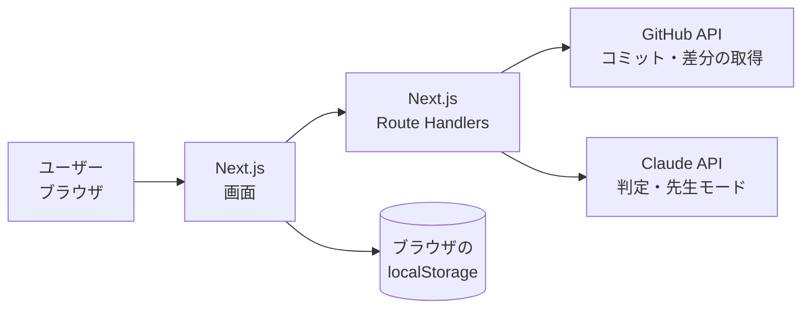

# 設計書

このプロダクトの唯一の設計書。**実装はこの設計書に準拠する。** 設計と違うことをしたくなったら、先にこの設計書を更新してから実装する。

設計書の前段階の議論は [docs/brainstorm/](brainstorm/README.md) に残す。決まったことだけをここに書く。

- ステータス：ドラフト（初版）
- 最終更新：2026-10-24

<!--
書き方のルール
- 決まったことだけを書く。未決のものは「13. 未決事項」に書く
- 【仮】が付いたものは、ひとまずこれで実装し、動くアプリを見ながら見直すもの
- 機密情報（APIキーの値、個人情報）は書かない。このリポジトリは public
-->

## 進め方

この設計書は、壁打ちで決まったことに、未決の部分を【仮】で埋めて作った初版。**ひとまずこの形で実装し、実際に動くアプリを見ながら設計書を修正していく。** 修正するときは、先にこの設計書を直してから実装を変える。

## 1. 概要

- **プロダクト名：** TBD
- **一言で：** AIが研究のコードを書く時代に、AIが黙って解決した問題を見逃さず、研究と実装の理解を取り戻す Web アプリ
- **○○ × Tech：** Research × Tech
- **テーマ：** 生成AI時代の研究の悩み解決
- **形態：** Web アプリ

## 2. 背景と課題

### 想定ユーザー

情報系の研究室で、生成AI（Claude Code、Codex など）を使いながら研究を進めている学生。

### 解決する課題

**A. 理解が追いつかない**

- ① 研究の進むスピードが速すぎて、それを理解できない自分がボトルネックになっている
- ③ 自分が意図していない実装になっていても気づかない
- ④ 先生に「ここどうなっている？」と聞かれて、理解できていないことが露呈する

**C. AIと自分の暴走**

- ⑥ エラーを修正するときに、AIが勝手に機能を付け足して、認知負荷が上がる
- ⑧ すぐ実装したがり、いつの間にか実装してしまう

これらは **実装** だけでなく **研究手法**（なぜこの手法か、どう評価するか、先行研究との違い）についても起きる。このプロダクトは両方の層を扱う。

### スコープ外

- **B. 問いと現在地を見失う**（② ⑤ ⑦ ⑨ ⑩）は、A と C ができて時間に余裕があれば取り組む。まずは A と C のデモを確実に動かすことを優先するため
- ⑧ 専用の機能（実装前チェック）は作らない。目的を明確にしておけば、AIの変更を取り込んで照合する段階で対応できるため
- 保存した問題の共有機能は作らない。自分で見返せればよい

## 3. コンセプトと解決方法

今のAIコーディングツールは「速く作る」（アクセル）ためのもの。このプロダクトは、人間が研究の **舵を握り続ける** ためのもの（ハンドルとブレーキ）。

核になる考え方は次の2つ。

1. **意図とずれた実装は「隠れた問題」のサイン。** AIが自分の目的と違う実装をしたときは、何かしらの問題があって、それをAIが勝手に解決したということ。ずれを「AIのミス」として消すのではなく、**自分が知らなかった問題（エラーとその対処）を見つける手がかり** として保存する。保存した問題がたまれば、先生に聞かれたときの答えになる（④）
2. **目的と理解は2層で扱う。** 研究の層（何を明らかにしたいか、どの手法で、どう評価するか）と、実装の層（今回AIに何を作らせるか）。AIの対処が研究の層に影響すること（例：欠損値のある行をAIが黙って除外し、データセットが変わる）も示す。汎用のコーディングツールにはない、研究ならではの観点

### 基本の流れ

1. 研究テーマを登録し、研究の目的（問い・手法・評価）を書く
2. AIに作業を頼んだら、その作業の目的を書く
3. AIが変更したコードを GitHub から取り込む
4. AIが変更と目的を照らし合わせ、ずれを見つけて判定する
   - **目的どおり**
   - **隠れた問題**：本当に問題があり、AIがそれに対処した → エラー内容と対処方法を保存する
   - **余計な追加**：頼んでいない追加 → 知らせる（保存はしない）
5. 先生モードで、AIが先生役として実装と研究手法の両方について質問し、理解を確かめる
6. 保存した問題を、あとで自分で見返す

## 4. 要件

### 機能要件

| ID | 機能 | 優先度 | 対応する課題 |
| --- | --- | --- | --- |
| F-1 | **研究テーマの登録**：研究テーマ（GitHub リポジトリに対応）ごとに、研究の目的（問い・手法・評価）を書く | Must | ① ④ |
| F-2 | **作業の目的の入力**：AIに頼んだ作業の目的を書く【仮：1〜2行の自由記述。AIに渡したプロンプトを貼ってもよい】 | Must | ③ ⑥ ⑧ |
| F-3 | **GitHub からの変更の取り込み**：リポジトリのコミットを選んで差分を取得する | Must | ③ ⑥ |
| F-4 | **ずれの判定**：AIが差分を作業の目的・研究の目的と照らし合わせ、変更を「目的どおり／隠れた問題／余計な追加」に分類する | Must | ③ ⑥ ⑧ |
| F-5 | **隠れた問題の保存**：エラー内容、対処方法、研究への影響（あり／なしと説明）、関係するファイルを保存する。エラー内容は【仮：差分とコミットメッセージから推測し、推測であることを明示する】 | Must | ① ③ ④ |
| F-6 | **余計な追加の通知**：頼んでいない追加を一覧で知らせる【仮：知らせるだけ】 | Must | ⑥ |
| F-7 | **問題ログの見返し**：保存した問題を研究テーマごとに時系列で一覧表示する | Must | ① ④ |
| F-8 | **先生モード**：AIが先生役で、保存した問題と研究の目的について質問する。質問は実装の層（「このエラーはなぜ起きた？」）と研究手法の層（「なぜこの手法？」「この評価指標で何が言える？」）の両方。ユーザーの回答にAIがフィードバックし、答えられなかった点を記録する | Must | ① ④ |
| F-9 | 問題ログのキーワード検索 | Should | ① |
| F-10 | PR 単位での取り込み | Should | ③ ⑥ |
| F-11 | B の機能（問いのアンカー、工程の表示など） | Could | ② ⑤ ⑦ ⑨ ⑩ |

<!-- 優先度：Must = デモに必須 / Should = 時間があれば / Could = Award Day に向けて -->

### 非機能要件

- APIキー（LLM、GitHub）はサーバー側だけで保持し、フロントエンドに含めない
- 研究のコードを LLM に送ることを、画面上でユーザーに明示する
- AIの判定は間違えることがある。判定結果はユーザーが確認・修正できるようにする

## 5. デモシナリオ

<!-- 審査で最重視されるのは「デモが動くこと」。この流れが通しで動くことを最優先に実装する -->

題材：デモ用に用意した、機械学習の実験コードのリポジトリ【仮】

1. **研究テーマを登録する。** 例：「〇〇データの分類で、手法Xは従来手法より精度が上がるか」。手法は X、ベースラインは Y、評価指標は F1
2. **作業の目的を書く。** 例：「データを読み込んでモデルXを学習・評価するスクリプトを作る」。この作業は事前に Claude Code に頼んで、コミットしておく
3. **GitHub からそのコミットを取り込む**
4. **判定結果を見る**
   - 目的どおり：学習・評価の処理
   - **隠れた問題**：「学習時に欠損値でエラー → 欠損値のある行を除外して対処」。**研究への影響あり**：データ件数が減り、ベースラインとの比較条件が変わる可能性
   - **余計な追加**：頼んでいないハイパーパラメータ探索の処理
5. **隠れた問題を保存する**
6. **先生モード。** AIが「欠損値を除外したことで、評価結果はどう変わりうる？」「なぜ評価指標に F1 を選んだ？」と質問 → 回答 → フィードバック。答えられなかった点が記録される
7. **問題ログを見返す。** ゼミの前に、この研究テーマで起きた問題を一覧で確認する

## 6. システム構成

### 構成図



### 技術スタック【仮】

| 領域 | 採用技術 | 理由 |
| --- | --- | --- |
| フロントエンド | Next.js（App Router）、TypeScript、Tailwind CSS | 画面とサーバー処理を1つのプロジェクトで扱える。AIに書かせやすい |
| バックエンド | Next.js の Route Handlers | 別のサーバーを立てずに済む。APIキーをサーバー側に置ける |
| AI / LLM | Claude API | 差分の判定と先生モードに使う |
| 外部連携 | GitHub REST API | コミットと差分の取得 |
| データの保存 | ブラウザの localStorage | 自分で見返せればよいので、まずはデータベースなしで始める。足りなくなったら Supabase に移す |
| デプロイ先 | Vercel | Next.js をそのまま公開できる |

## 7. 画面・UX

| ID | 画面 | 内容 |
| --- | --- | --- |
| S-1 | 研究テーマ一覧・登録 | 研究テーマと研究の目的（問い・手法・評価）の登録と一覧（F-1） |
| S-2 | 変更の取り込み | 作業の目的の入力と、GitHub のコミットの選択（F-2、F-3） |
| S-3 | 判定結果 | 変更を「目的どおり／隠れた問題／余計な追加」に分けて表示。隠れた問題には研究への影響を表示し、保存できる（F-4〜F-6） |
| S-4 | 問題ログ | 保存した問題を研究テーマごとに時系列で一覧。詳細でエラー内容・対処方法・研究への影響を見る（F-7） |
| S-5 | 先生モード | AIの質問に答え、フィードバックを受ける。答えられなかった点が残る（F-8） |

操作の順番：S-1 → S-2 → S-3 →（保存）→ S-4 ⇄ S-5

## 8. データ設計【仮】

```ts
// 研究テーマ（研究の層）
type ResearchTheme = {
  id: string;
  name: string;
  repo: string;           // "owner/name"
  question: string;       // 何を明らかにしたいか
  method: string;         // どの手法で（ベースラインを含む）
  evaluation: string;     // どう評価するか（評価指標など）
  updatedAt: string;
};

// 取り込んだ変更と判定（実装の層）
type Review = {
  id: string;
  themeId: string;
  purpose: string;        // 作業の目的
  commitSha: string;
  createdAt: string;
  findings: Finding[];
};

type Finding = {
  id: string;
  type: "on_purpose" | "hidden_problem" | "extra_addition";
  summary: string;
  files: string[];
  // 以下は hidden_problem のときだけ
  error?: string;              // エラー内容
  errorIsInferred?: boolean;   // 差分などからの推測なら true
  fix?: string;                // 対処方法
  researchImpact?: { exists: boolean; description: string };
  saved?: boolean;             // 問題ログに保存したか
};

// 先生モード
type TeacherSession = {
  id: string;
  themeId: string;
  findingId?: string;
  createdAt: string;
  items: {
    layer: "research" | "implementation";
    question: string;
    answer: string;
    feedback: string;
    understood: boolean;   // false のものを「答えられなかった点」として残す
  }[];
};
```

## 9. API・インターフェース【仮】

| メソッドとパス | 内容 |
| --- | --- |
| `GET /api/github/commits?repo=owner/name` | リポジトリのコミット一覧を返す |
| `GET /api/github/diff?repo=owner/name&sha=...` | コミットの差分とコミットメッセージを返す |
| `POST /api/review` | 研究の目的・作業の目的・差分を受け取り、`Finding[]` を返す |
| `POST /api/teacher/questions` | 研究の目的と保存した問題を受け取り、質問を返す |
| `POST /api/teacher/feedback` | 質問と回答を受け取り、フィードバックと `understood` を返す |

LLM の出力は JSON で受け取り、型に合うか検証してから画面に出す。

## 10. 外部サービスと環境変数

<!-- 環境変数は名前と用途だけを書く。値は .env に置き、絶対にここに書かない -->

| 環境変数 | 用途 |
| --- | --- |
| `ANTHROPIC_API_KEY` | Claude API の呼び出し |
| `GITHUB_TOKEN` | GitHub API の呼び出し（レート制限の回避、private リポジトリの読み取り） |

## 11. 開発計画

### 担当【仮】

チームは3人。

| メンバー | 担当 |
| --- | --- |
| TBD | 画面（S-1〜S-5） |
| TBD | API と LLM まわり（GitHub 連携、判定と先生モードのプロンプト） |
| TBD | デモ用の題材リポジトリ、発表資料、README |

### マイルストーン

| いつ | 到達点 |
| --- | --- |
| Day1 19:10 中間発表 | 1つのコミットを取り込み、判定結果（S-3）が表示できる |
| Day2 15:00 Code Freeze | デモシナリオが通しで動く |
| Day2 15:30 | 作品提出フォームを提出 |
| 10/26(月) AM8:00 審査開始 | README（デモ動画リンク・作品情報）を main に反映済み |

## 12. 審査基準との対応

| 審査基準 | どう満たすか |
| --- | --- |
| 問題着眼点・着想点 | 「AIの速さに人間の理解が追いつかない」という生成AI時代ならではの新しい問題。意図とのずれを「隠れた問題」のサインとして捉え直す着想 |
| 実行・実現可能性 | 想定ユーザー（情報系の研究室の学生）は自分たち自身。審査員の先生方も指導する側としてこの問題を日々見ている |
| 完成度・動作性 | デモシナリオ（コミットの取り込み → 判定 → 保存 → 先生モード）が通しで動くこと |
| プレゼンテーション力（Award Day） | 先生に聞かれて答えられない場面から始め、このアプリで答えられるようになる流れで見せる |

## 13. 未決事項

<!-- 決まったら該当セクションに移して、ここから消す -->

- [ ] プロダクト名
- [ ] 作業の目的の入力方法（F-2）。今は【仮】で1〜2行の自由記述
- [ ] エラー内容の得方（F-5）。今は【仮】で差分とコミットメッセージからの推測
- [ ] 余計な追加の扱い（F-6）。今は【仮】で知らせるだけ
- [ ] 問題ログの見返し方（F-7、F-9）。今は【仮】で時系列の一覧
- [ ] 研究手法について「目的や理解が追いつかない」具体的な場面（先生モードの質問とデモの題材に使う）
- [ ] 【仮】が付いた技術スタック・データ設計・API

## 変更履歴

| 日付 | 内容 |
| --- | --- |
| 2026-10-24 | 雛形を作成。テーマを記載 |
| 2026-10-24 | 想定ユーザー、解決する課題（A＋C）、スコープ外（B）、形態（Web アプリ）、チーム人数を記載 |
| 2026-10-24 | 初版を作成。壁打ちの決定事項に未決部分を【仮】で埋め、全章を記載 |
