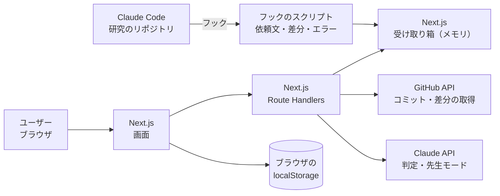

# 設計書

このプロダクトの唯一の設計書。**実装はこの設計書に準拠する。** 設計と違うことをしたくなったら、先にこの設計書を更新してから実装する。

設計書の前段階の議論は [docs/brainstorm/](brainstorm/README.md) に残す。決まったことだけをここに書く。

- ステータス：ドラフト（初版）
- 最終更新：2026-10-24

<!--
書き方のルール
- 決まったことだけを書く。未決のものは「13. 未決事項」に書く
- 【仮】が付いたものは、ひとまずこれで実装し、動くアプリを見ながら見直すもの
- 機密情報（APIキーの値、個人情報）は書かない。このリポジトリは public
-->

## 進め方

この設計書は、壁打ちで決まったことに、未決の部分を【仮】で埋めて作った初版。**ひとまずこの形で実装し、実際に動くアプリを見ながら設計書を修正していく。** 修正するときは、先にこの設計書を直してから実装を変える。

## 1. 概要

- **プロダクト名：** TAZUNA
- **一言で：** AIが研究のコードを書く時代に、AIが黙って解決した問題を見逃さず、研究と実装の理解を取り戻す Web アプリ
- **○○ × Tech：** Research × Tech
- **テーマ：** 生成AI時代の研究の悩み解決
- **形態：** Web アプリ

## 2. 背景と課題

### 想定ユーザー

情報系の研究室で、生成AI（Claude Code、Codex など）を使いながら研究を進めている学生。

### 解決する課題

**A. 理解が追いつかない**

- ① 研究の進むスピードが速すぎて、それを理解できない自分がボトルネックになっている
- ③ 自分が意図していない実装になっていても気づかない
- ④ 先生に「ここどうなっている？」と聞かれて、理解できていないことが露呈する

**C. AIと自分の暴走**

- ⑥ エラーを修正するときに、AIが勝手に機能を付け足して、認知負荷が上がる
- ⑧ すぐ実装したがり、いつの間にか実装してしまう

これらは **実装** だけでなく **研究手法**（なぜこの手法か、どう評価するか、先行研究との違い）についても起きる。このプロダクトは両方の層を扱う。

### スコープ外

- **B. 問いと現在地を見失う**（② ⑤ ⑦ ⑨ ⑩）は、A と C ができて時間に余裕があれば取り組む。まずは A と C のデモを確実に動かすことを優先するため
- ⑧ 専用の機能（実装前チェック）は作らない。目的を明確にしておけば、AIの変更を取り込んで照合する段階で対応できるため
- 保存した問題の共有機能は作らない。自分で見返せればよい

## 3. コンセプトと解決方法

今のAIコーディングツールは「速く作る」（アクセル）ためのもの。このプロダクトは、人間が研究の **舵を握り続ける** ためのもの（ハンドルとブレーキ）。

核になる考え方は次の2つ。

1. **意図とずれた実装は「隠れた問題」のサイン。** AIが自分の目的と違う実装をしたときは、何かしらの問題があって、それをAIが勝手に解決したということ。ずれを「AIのミス」として消すのではなく、**自分が知らなかった問題（エラーとその対処）を見つける手がかり** として保存する。保存した問題がたまれば、先生に聞かれたときの答えになる（④）
2. **目的と理解は2層で扱う。** 研究の層（何を明らかにしたいか、どの手法で、どう評価するか）と、実装の層（今回AIに何を作らせるか）。AIの対処が研究の層に影響すること（例：欠損値のある行をAIが黙って除外し、データセットが変わる）も示す。汎用のコーディングツールにはない、研究ならではの観点

### 基本の流れ

1. 研究テーマを登録し、研究の目的（問い・手法・評価）を書く
2. Claude Code に作業を頼む。その依頼文が、そのまま作業の目的になる
3. AIが作業を終えると、変更したコードと、作業中に起きたエラーが、フックで自動的にアプリに届く（GitHub のコミットを選んで取り込むこともできる）
4. AIが変更と目的を照らし合わせ、ずれを見つけて判定する
   - **目的どおり**
   - **隠れた問題**：本当に問題があり、AIがそれに対処した → エラー内容と対処方法を保存する
   - **余計な追加**：頼んでいない追加 → 知らせる（保存はしない）
5. 先生モードで、AIが先生役として実装と研究手法の両方について質問し、理解を確かめる
6. 保存した問題を、あとで自分で見返す

## 4. 要件

### 機能要件

| ID | 機能 | 優先度 | 対応する課題 |
| --- | --- | --- | --- |
| F-1 | **研究テーマの登録**：研究テーマ（GitHub リポジトリに対応）ごとに、研究の目的（問い・手法・評価）を書く。画面上では研究テーマを**プロジェクト**と呼ぶ。リポジトリは、GitHub から取ってきた自分のリポジトリの一覧から選ぶ（`GITHUB_TOKEN` で取得。トークンが無いときや取得に失敗したときは `owner/name` を手で入力する）。同じリポジトリのプロジェクトは1つだけ作れる（登録済みのリポジトリは一覧で選べない） | Must。プロジェクトは削除できる。削除すると、そのプロジェクトの取り込んだ変更（判定と差分）・保存した問題・先生モードの記録・作業フローマップもまとめて消す（元に戻せないので、消えるものの件数を見せて確かめてから消す） | ① ④ |
| F-2 | **作業の目的の入力**：AIに頼んだ作業の目的を書く。フック（F-13）で取り込むときは、Claude Code への依頼文をそのまま使い、学生が目的を書き直す場面は設けない（直したいときは判定結果の画面で直して判定し直す）。コミットを選んで取り込むときは【仮：1〜2行の自由記述。AIに渡したプロンプトを貼ってもよい】 | Must | ③ ⑥ ⑧ |
| F-3 | **GitHub からの変更の取り込み**：リポジトリのコミットを選んで差分を取得する。フックを入れていないとき、過去のコミットを判定したいとき、デモの予備に使う | Must | ③ ⑥ |
| F-4 | **ずれの判定**：AIが差分を作業の目的・研究の目的と照らし合わせ、変更を「目的どおり／隠れた問題／余計な追加」に分類する。データの問題（欠損値・外れ値・型など）への対処（補完・除外・変換）は、作業の目的で頼まれていなければ、エラーが起きていなくても隠れた問題とする（AIが先回りして黙って対処した問題のため） | Must | ③ ⑥ ⑧ |
| F-5 | **隠れた問題の保存**：エラー内容、対処方法、研究への影響（あり／なしと説明）、関係するファイルを保存する。エラー内容は、フック（F-13）で取り込んだときは会話記録に残った実際のエラーを使う。実際のエラーがないとき（コミットから取り込んだときなど）は、差分とコミットメッセージから推測し、推測であることを明示する | Must | ① ③ ④ |
| F-6 | **余計な追加の通知**：頼んでいない追加を一覧で知らせる【仮：知らせるだけ】 | Must | ⑥ |
| F-7 | **問題ログの見返し**：保存した問題を研究テーマごとに時系列で一覧表示する | Must | ① ④ |
| F-8 | **先生モード**：AIが先生役で、保存した問題と研究の目的について質問する。質問は実装の層（「このエラーはなぜ起きた？」）と研究手法の層（「なぜこの手法？」「この評価指標で何が言える？」）の両方。ユーザーの回答に対して、AIは答えを言わずに問い返し、1つの質問について最大3往復やりとりする（聞き方は「7. 画面・UX」の「先生の聞き方」）。質問ごとに想定解答の「観点」を作っておき、必須の観点がそろったら「理解できた」で終える（「7. 画面・UX」の「観点による採点」）。最後に講評し、答えられなかった点を記録する | Must | ① ④ |
| F-9 | 問題ログのキーワード検索 | Should | ① |
| F-10 | PR 単位での取り込み | Should | ③ ⑥ |
| F-11 | B の機能（問いのアンカーなど）。工程の表示は F-15 で扱う | Could | ② ⑤ ⑦ ⑨ ⑩ |
| F-12 | **デモモード**：ヘッダーの切り替えで、GitHub と Claude API を呼ばずに、用意したデモデータ（デモシナリオの題材）で S-2〜S-5 を通しで動かす。デモ用の研究テーマをボタン1つで作れる | Must | 審査のデモ |
| F-13 | **Claude Code のフックからの自動取り込み**：Claude Code に頼んだ作業が終わるたびに、依頼文・AIが変更した差分（未コミットのままでよい）・作業中に起きたエラーを、手元で動かしているアプリに自動で送り、判定する。詳しくは「6. システム構成」の「Claude Code のフック（F-13）」 | Must | ③ ⑥ ⑧ |
| F-14 | **コードの差分の表示**：判定結果の画面で、AIが変えたコードの差分（`+` / `-` の行）を見られる。判定の各項目では関係するファイルの差分を開いて見られ、画面の下には変更全体の差分を置く。差分には元と変更後の行番号を付け、変更の無い行を省いたところ（ファイルの先頭や、変更のかたまりの間）は「変更のない N 行」と示す | Must | ③ ⑥ |
| F-15 | **作業フローマップ**：研究の工程をレーン（調査・選定・実装・検証・報告。増減できる）に分け、レーンごとのタスクとサブタスク、その目的と状態、タスク同士のつながりを1枚に見せる。AI が research-workspace と実装リポジトリを読んで目的まで全部作り（場面1）、人が後から直す（場面2）。変更を取り込むたびに自動で更新し、隠れた問題が研究の前提に影響するときは逆向きの矢印を引く（場面3）。人が消したものは覚えておき、AI が再び提案しないようにする。デモモード（F-12）ではデモデータで、それ以外は本物の research-workspace と実装リポジトリ（GitHub）から作る。詳しくは「7. 画面・UX」の「作業フローマップ（F-15）」 | Must | ⑩ ⑦ ⑧ ④ |
| F-16 | **ページを移るメニュー**：全画面のヘッダーの左上にハンバーガーメニューを置き、プロジェクト一覧・新しいプロジェクトと、開いているプロジェクトの各画面（詳細・取り込み・先生モード・作業フローマップ）、ほかのプロジェクトへ移れる | Should | 使いやすさ |
| F-17 | **AI の設定と使用量**：設定画面（S-8）で、判定・先生モード・作業フローマップのそれぞれについて、使う Claude のモデル（Haiku 5.5 ／ Sonnet 5.5 ／ Opus 5.5）とエフォート（標準 ／ low ／ medium ／ high）を選べる。AI を呼ぶたびに使ったトークン数とおおよその料金を記録し、今日の分と合計を機能・モデルごとに見られる | Should | 費用の管理 |
| F-18 | **接続の設定**：設定画面（S-8）の「接続」で、Claude API キーと GitHub トークンを入れられる。アプリのサーバーが手元の設定ファイル（`~/.tazuna/config.json`、本人だけが読める権限）に保存し、画面には値を返さない（設定済みかどうかと末尾4文字だけ）。「接続を確かめる」で実際に呼べるか試せる。画面で入れていなければ、今までどおり `web/.env.local` の値を使う。フックの合言葉（`RESEARCH_CHECK_TOKEN`）は人が入れなくてよいよう、無ければアプリが自動で作って同じファイルに保存する。キーが無いまま使おうとしたら、設定画面へ案内する | Must | 使い始めやすさ |
| F-19 | **使い方ガイド**：アプリの流れと各機能（プロジェクト・取り込みと判定・Claude Code のフック・先生モード・作業フローマップ・設定）を、実際の画面のスクリーンショットで紹介するページ。メニューの「全体」と、ホームの見出しの横のリンクから開く。スクリーンショットはその時点の画面で撮ったもので、機能や見た目を変えるたびには撮り直さず、最終提出の前にまとめて撮り直す | Could | 使い始めやすさ |

<!-- 優先度：Must = デモに必須 / Should = 時間があれば / Could = Award Day に向けて -->

### 非機能要件

- APIキー（LLM、GitHub）はサーバー側だけで保持し、フロントエンドに含めない。画面から入れたキー（F-18）も、サーバーが手元のファイルに保存し、ブラウザ（localStorage など）には置かない。画面にもログにもエラーにも値を出さない
- 研究のコードを LLM に送ることを、画面上でユーザーに明示する
- AIの判定は間違えることがある。判定結果はユーザーが確認・修正できるようにする

## 5. デモシナリオ

<!-- 審査で最重視されるのは「デモが動くこと」。この流れが通しで動くことを最優先に実装する -->

題材：拡散モデル（DDPM）の小さな研究リポジトリ。2次元のトイデータ（swiss roll）で、**ノイズスケジュールを linear から cosine に変えると生成の質が上がるか** を調べる。CPU だけで1回の学習が数秒で終わるので、会場でも Claude Code に実際に作業させられる

- 研究の目的：提案側は cosine スケジュール、ベースラインは linear スケジュール。データ・モデル・拡散のステップ数 T・学習の設定・サンプリングはそろえ、変えるのはスケジュールだけ。評価は、生成した点と本物の点の sliced Wasserstein 距離（元のスケールのまま測る）を、seed 3つの平均と標準偏差で比べる
- 題材には、AI が黙って「直し」たくなる点が自然に含まれている
  - データが元のスケール（座標がおよそ −10〜15）のままで、正規化されていない
  - T=200 の linear スケジュールでは、最後のステップがまだ純粋なノイズになりきっていない
  - AI がデータを正規化したり、T やスケジュールの細部を変えたりすると、「変えるのはスケジュールだけ」「元のスケールで測る」という研究の条件が崩れる

1. **研究テーマを登録する。** 上の研究の目的（問い・手法・評価）を書く
2. **Claude Code に作業を頼む。** 例：「cosine スケジュールを追加して、linear と cosine を README の評価方法で比べる compare.py を作って、実行して確かめて」。題材のリポジトリにはフック（F-13）を入れておく
3. **AIの作業が終わると、変更が自動でアプリに届く。** 依頼文が作業の目的になり、作業中に起きたエラーと AI の最終報告も一緒に届く
4. **判定結果を見る**（AI の作業は毎回少しずつ違うので、以下は想定の例）
   - 目的どおり：cosine スケジュールの追加と、比較の処理
   - **隠れた問題**：例「元のスケールのままでは生成がうまくいかない（または学習が不安定になる）→ AI がデータを正規化して対処」。**研究への影響あり**：評価は元のスケールで測る決まりなので、正規化したまま測ると距離の値の意味が変わる。linear の結果も同じ条件で取り直す必要がある
   - **余計な追加**：例「頼んでいない学習率の調整や、重みの移動平均（EMA）の追加」
   - コードの差分（F-14）で、AI が実際に何を変えたかを確かめる
5. **隠れた問題を保存する**
6. **先生モード。** AIが「データを正規化したことで、sliced Wasserstein 距離の値はどう変わりうる？」（実装の層）、「cosine スケジュールにすると、なぜ生成の質が変わると考えられる？ そのとき T をそろえる意味は？」（研究手法の層）と質問 → 回答 → フィードバック。答えられなかった点が記録される
7. **問題ログを見返す。** ゼミの前に、この研究テーマで起きた問題を一覧で確認する

作業フローマップ（F-15）は、1 と 4 の間に挟んで見せる。

- 1 のあと：作業フローマップを開き、研究の工程の「今ここ」と、不採用にした案（例：FID・IS だけで評価するのをやめた理由）を見せる
- 4 のあと：判定結果の画面に「マップに N 件反映しました」と出る。マップを開くと、実装レーンにコミットが増え、隠れた問題（データの正規化、cosine の β の上限）から選定レーンの spec の決定事項へ「研究への影響」の矢印が引かれ、頼んでいない追加（散布図の保存と --quick オプション）が「記録のない実装」として出ている

会場で Claude Code の作業が思うように進まないときに備えて、同じ作業を事前にコミットしておき、2〜3 は「GitHub からそのコミットを取り込む」（F-3）でも見せられるようにする。予備のコミットは、本番用の題材リポジトリ（`ddpm-noise-schedule`）とは別の **予備用リポジトリ（`ddpm-noise-schedule-backup`）** に置く。本番用の main にコミットすると、会場の Claude Code が「cosine はもう入っている」状態から始めてしまうため。予備用リポジトリは、本番用と同じ最初のコミットに、AI が実際に行った作業（Claude Code に上の依頼をして得た変更）を1つのコミットとして足したもの。会場では予備用リポジトリのプロジェクトを開き、そのコミットを取り込んで判定する。予備用リポジトリにも本番用と同じくフックを入れておき、Claude Code に作業させる道でも使えるようにする（同じリポジトリのプロジェクトは、デモに使うブラウザ1つにだけ登録する。複数のブラウザに登録すると、届いた変更を先に開いた方が取ってしまうため）。題材の罠の説明は、コミットメッセージを含めて予備用リポジトリにも書かない

デモモードを切った本番のデモで作業フローマップを作るために、本物の research-workspace として公開リポジトリ **`ddpm-research-workspace`**（プロジェクト名 `ddpm-noise-schedule`）を用意する。中身はデモモードの架空のワークスペースと同じ研究の記録（壁打ち・論文メモ・spec・ゼミの記録・実験記録・中間報告の資料、README のマイルストーン）で、本番用と予備用のどちらのプロジェクトもこれを指す。題材リポジトリの中には置かない。会場の Claude Code が spec を読むと、AI が黙って対処する場面が出なくなるため。AI が足しそうな対処（データの正規化、β の上限の変更）や、頼まれずに足しそうな追加（散布図の保存など）は、記録に書かない（マップで「記録に無い案」「記録のない実装」として出すため）

### デモモード（F-12）

会場のネットワークや API の不調でデモが止まらないように、外部サービスを使わずにこのシナリオを通せるモードを用意する。

- ヘッダーの「デモモード」で切り替える。状態はブラウザの localStorage に保存する
- デモモード中は、画面から API を呼ぶ関数（`web/src/lib/api-client.ts`）が、サーバーを呼ばずに `web/src/lib/demo/` のデモデータを返す。AI が考えている感じを出すため、少し待ってから返す
- 研究テーマ一覧の「デモ用の研究テーマを作る」で、上の題材の研究テーマを登録する。デモデータ（`web/src/lib/demo/`）も上の題材（拡散モデル）に合わせる
- 先生モードのフィードバックは、回答に含まれるキーワードで「理解できた／まだ理解できていない」を決める。「わかりません」と答えると、答えられなかった点として残る
- デモモード中は画面上に「デモモード」と常に表示し、本物の判定と取り違えないようにする
- 作業フローマップ（F-15）は、デモ用のプロジェクトにだけデモデータ（`web/src/lib/demo/workflow-map.ts`）がある。research-workspace の形式の小さな架空のワークスペース（`demo-lab/research-workspace`、プロジェクト `ddpm-noise-schedule`）から作った体のマップで、デモ用のコミット（cosine スケジュールと比較スクリプト）を取り込むと、決まった変更が反映される

## 6. システム構成

### 構成図



アプリは、学生が自分の PC で動かす（`npm run dev` などで localhost に立てる）前提とする。フックは localhost のアプリに送る。

### Claude Code のフック（F-13）

研究のリポジトリで Claude Code に作業を頼むと、次の流れで判定まで進む。

1. **依頼したとき（`UserPromptSubmit` フック）**
   - **前の依頼が閉じていなければ、先にその分を送る**：前の依頼のあと 2 が動かなかったとき（Esc で中断した、Claude Code が落ちたなど）は、新しいスナップショットを取る前に、前の依頼の分の差分を、前の依頼文と一緒に 2 と同じ手順で送る。中断した回の変更を取りこぼさないため
   - 依頼文を、会話（`session_id`）ごとの依頼の履歴に追加する。`/` で始まる依頼（`/commit` などのスラッシュコマンド）は、作業の目的にならないので履歴に入れない
   - その時点の HEAD（コミット）を記録する
   - その時点の作業ツリーの状態（未コミットの変更や新しいファイルも含めたスナップショット）を取り、この依頼を「開いている」状態にする。**1MB を超えるファイルは対象から外す**（データセットやモデルの重みで、依頼のたびに待たされたり `.git` が膨らんだりしないように）
   - どれも研究のリポジトリの `.git/research-check/` に保存する。`.git/` の中なので、コミットにも差分にも入らない
2. **AIが返事を終えたとき（`Stop` フック）**
   - **送れなかった分を先に送り直す**（下の「送れなかったとき」を参照）
   - スナップショットと今の作業ツリー（同じく 1MB を超えるファイルは除く）を比べて、**AI が変えた差分** を作る。学生が依頼の前に自分で変えていた部分は入らない
   - **差分が空なら何も送らない**（質問に答えただけの回など。判定の回数と費用を抑えるため）。実験の出力（次の項目）だけが変わったときも送らない
   - **実験の出力は中身を送らない**：拡張子が実験の出力によくあるファイル（`.csv`、`.tsv`、`.log`、`.png`、`.jpg`、`.pdf`、`.pt`、`.pth`、`.ckpt`、`.npy`、`.npz`、`.pkl`、`.h5`、`.parquet` など）は、差分の中身を送らず、「実行でできたファイル」としてファイル名だけ送る。AI が学習や評価を実行したときの出力を、AI が書いたコードとして判定しないため
   - **途中で pull や切り替えがあったら知らせる**：1 で記録した HEAD から、今の HEAD が子孫でない（ブランチの切り替えや巻き戻し）、あいだにマージコミットがある、または自分（git の `user.email`）以外が作ったコミットが入っている、のどれかなら、その印を付けて送る。差分にほかの人の変更が混ざっている可能性を、判定結果に表示するため
   - **作業の目的**は、今回の依頼文に加えて、同じ会話でそれまでにした依頼文（直近5件まで）も一緒に送る。「続けて」「エラー直して」のような短い依頼でも、最初の依頼から目的がわかるようにするため
   - 会話記録（フックに渡される `transcript_path`）から、この依頼のあいだに **実際に起きたエラー** を取り出す。合わせて最大10件、1件あたり2,000文字まで。次の2種類を拾う。**取るのは `Bash` の結果だけ**で、雑音を減らすために次のように絞る
     - **失敗したコマンド**：`Bash` の結果で、コマンドが実際に失敗したもの（出力が `Exit code` で始まる）。Claude Code 自身のメッセージ（許可の確認や、コマンドの検査で止めたもの）や、ユーザーが許可しなかったものは、プログラムのエラーではないので捨てる。次も捨てる
       - **探索・ファイルの後始末のコマンド**だけでできたコマンド（`cat`・`sed`・`grep`・`git`・`ls`・`find`・`echo`・`diff`・`mkdir`・`cp`・`rm`・`cd` など。パイプや `&&`、ヒアドキュメントで区切って、全部がこの種類のとき）。失敗も出力も無視する。ソースコードや差分を表示しただけで、`Error` などの言葉が出てしまうため
       - **終了コード 1 が「見つからない・偽・違いがある」だけの意味のコマンド**（最後が `grep`・`rg`・`diff`・`test`・`which` など）。`grep` の0件など、失敗したが問題ではないものを拾わないため。終了コード 2 以上や、最後がそれ以外のコマンド（`python train.py | tail` など）の失敗は残す
     - **出力に出たエラー**：コマンドとしては成功したが、出力に `Traceback`・`Error`・`Exception`・`failed` などのエラーらしい行があるもの。例外を捕まえて表示しただけ、ライブラリが警告を出しただけ、のように、本物のエラーは成功したコマンドの出力に出ることが多いため。エラーらしい行のまわりだけを取る
       - 会話記録に標準出力と標準エラー出力が分かれて残っているときは、エラーらしい行を**標準エラー出力だけ**から探す。標準出力には、AI が表示したコードや差分が混ざるため。`2>&1` で標準エラー出力を標準出力に混ぜているコマンドは、標準出力からも探す。分かれていない形式のときは、出力の全体から探す
       - **数値の異常**も拾う。研究の問題は、学習が発散して値が `nan`・`inf` になる、`overflow encountered`・`invalid value encountered`・`divide by zero encountered`（NumPy の警告）のように、`Error` と表示されずに起きることが多いため。標準出力と標準エラー出力の両方から探し、探索のコマンドは見ない。`np.nan`・`float('inf')`・`isnan` のような、コードに書かれた名前は数値の異常として拾わない。`diverg` は `KL divergence` のような普通の指標名があるので見ない。エラーらしい行と同じ結果から拾ったときは、1件にまとめる
   - 会話記録から、**AI の最終報告**（この依頼のあいだの AI の最後の返事の文章）も取り出す。3,000文字まで。AI は「欠損があったので補完した」「`ValueError` を確認した」のように、自分が気づいて対処したことを報告に書くことが多く、判定の手がかりになるため
   - **会話記録が読めないとき（形式が変わったときなど）は、エラーと最終報告なしで送る**。会話記録の中身は Claude Code の公開された仕様ではないため
   - 依頼文・差分・エラー・最終報告の中の、API キーやトークンらしい文字列は伏せ字にしてから送る
   - 研究のリポジトリの `origin` から `owner/name` を求め、全部をアプリの受け取り箱（`POST /api/hook/changes`）に送る。送ったらすぐに終わり、Claude Code を待たせない
   - **送ったら、スナップショットを今の状態に更新し、依頼を「閉じた」状態にする**。2 は学生の依頼がなくても動くことがある（AI が裏で動かしていた学習の終了を受けて作業を再開したときなど）。そのとき、前に送った変更を二重に送らないようにするため
   - **送れなかったとき**（アプリが止まっているなど）は、送る内容を `.git/research-check/` に貯めておき、次に 1 か 2 が動いたときに送り直す。貯めるのは20件までで、古いものから消す。送れなくても、Claude Code の作業は止めない
3. **アプリの受け取り箱**：サーバーのメモリに一時的に置くだけ（データベースは使わない）。次の守りを入れる
   - **合言葉**：フックからの `POST` は、アプリとフックで同じ値を持つ合言葉（`RESEARCH_CHECK_TOKEN`）が `Authorization` ヘッダーに付いているものだけ受け付ける。アプリに合言葉が設定されていなければ、受け取り箱は使えない
   - **ほかのサイトからのリクエストを拒否**：`POST` は、`Origin` ヘッダーが付いたもの（ブラウザから送られたもの）を拒否する。`GET` と `DELETE` は、このアプリ自身の画面からのものだけ受け付ける
   - **localhost 以外を拒否**：`Host` ヘッダーが `localhost` か `127.0.0.1` のものだけ受け付ける
   - 置いておく件数に上限をかけ（50件）、古いものから消す
4. **ブラウザ**：アプリを開いているあいだ、受け取り箱を数秒おきに確認する。届いた変更の `owner/name` と同じリポジトリの研究テーマがあれば、その研究の目的と一緒に判定（`POST /api/review`）し、結果を localStorage に保存して知らせる。研究テーマがなければ、登録を促す
   - 複数のタブで同じ変更を二重に判定しないよう、受け取り箱から取り出した（削除できた）タブだけが判定する
   - localStorage の容量（5MB ほど）があふれないよう、保存するエラー出力は1件あたり500文字までに切る。差分は、表示（F-14）と目的を直した再判定（5）のために、ブラウザの IndexedDB に保存する（localStorage より大きく保存できるため）
5. **判定結果の画面（S-3）**：フックで届いた判定では、作業の目的（今回とそれまでの依頼文）を表示し、目的を直してもう一度判定できるようにする。依頼文が目的として不十分なとき（AI が途中で止まった、依頼が短すぎたなど）に直すため

フックのスクリプトはこのリポジトリの `hook/` に置き、依存パッケージなしの Node.js で書く。合言葉は環境変数 `RESEARCH_CHECK_TOKEN` から読み、無ければこのリポジトリの `web/.env.local` から読む（同じ PC で動かすので、設定を1か所で済ませるため）。学生は、研究のリポジトリの `.claude/settings.local.json`（コミットしない設定ファイル）に、このスクリプトを `UserPromptSubmit` と `Stop` のフックとして登録する。手順は `hook/README.md` に書く。

### 技術スタック【仮】

| 領域 | 採用技術 | 理由 |
| --- | --- | --- |
| フロントエンド | Next.js（App Router）、TypeScript、Tailwind CSS | 画面とサーバー処理を1つのプロジェクトで扱える。AIに書かせやすい |
| バックエンド | Next.js の Route Handlers | 別のサーバーを立てずに済む。APIキーをサーバー側に置ける |
| AI / LLM | Claude API（標準のモデルは Claude Haiku 5.5） | 差分の判定と先生モードに使う。判定の回数が増えても費用を抑えられるよう、Opus 5.5 の約40分の1の Haiku を標準にする。質が足りなければ、設定画面（S-8、F-17）で機能ごとに Sonnet 5.5 や Opus 5.5 に上げられる |
| 外部連携 | GitHub REST API | コミットと差分の取得 |
| データの保存 | ブラウザの localStorage（差分だけは IndexedDB） | 自分で見返せればよいので、まずはデータベースなしで始める。足りなくなったら Supabase に移す |
| フック | Claude Code のフック（`UserPromptSubmit`、`Stop`）と、Node.js のスクリプト（依存パッケージなし） | AIの作業が終わった時点で、依頼文・差分・実際のエラーを取れる。学生の PC に追加で入れるものがない |
| 動かす場所 | 学生の PC（localhost）。Vercel にも公開できるが、そこではフック（F-13）は使えない | フックの受け取り箱をメモリに置くため。データベースと認証を持たずに済む |

## 7. 画面・UX

| ID | 画面 | URL | 内容 |
| --- | --- | --- | --- |
| S-1 | プロジェクトの選択（ホーム） | `/` | プロジェクトをカードで並べ、選ぶと S-4 に入る。カードには名前・リポジトリ・保存した問題の数・最後に取り込んだ日時を出す。「新しいプロジェクト」で S-6 へ。見出しの横に「使い方」（S-9）へのリンクを置く。デモモードのときは、デモ用のプロジェクトを作るボタンも出す（F-1、F-12） |
| S-6 | 新しいプロジェクト | `/projects/new` | 2段階。① GitHub のリポジトリを一覧から選ぶ（名前で絞り込み、private の印、最後に push した日時。登録済みのものは選べず、そのプロジェクトへのリンクを出す。トークンが無いときや取得に失敗したときは `owner/name` を手で入力する）② 研究の目的（問い・手法・評価）とプロジェクト名を書いて登録し、S-4 へ。`?repo=owner/name` で開くと ① を選んだ状態から始める（フックの知らせ「プロジェクトが未登録」から来たとき）（F-1） |
| S-4 | 研究テーマの詳細・問題ログ | `/themes/[themeId]` | 上部に、Claude Code のフック（F-13）で変更が自動で届くことの案内を主役として置き（研究のリポジトリにフックを入れておくこと、届くと右下に知らせが出ること、使い方の「Claude Code のフック」の節へのリンク）、先生モード・作業フローマップのボタンと、目立たない副ボタン「コミットから取り込む」（S-2）を並べる。デモモードではフックを使わないので、案内の代わりに「コミットから取り込む」のボタンを出す（下の副ボタンは出さない）。研究の目的の表示と編集、取り込んだ変更の一覧、保存した問題を時系列で一覧。詳細でエラー内容・対処方法・研究への影響を見る。画面のいちばん下に「プロジェクトを削除」を置き、押すと、消えるもの（取り込んだ変更・保存した問題・先生モードの記録の件数、作業フローマップの有無）を並べた確認を出す。「削除する」で消してプロジェクト一覧（S-1）へ戻る（F-1、F-7） |
| S-2 | コミットからの取り込み | `/themes/[themeId]/reviews/new` | 作業の目的の入力と、GitHub のコミットの選択（F-2、F-3）。取り込みの主な方法はフック（F-13）なので、S-4 では目立たない副ボタン「コミットから取り込む」から開く。デモモードではここからデモのコミットを取り込む |
| S-3 | 判定結果 | `/reviews/[reviewId]` | 変更を「目的どおり／隠れた問題／余計な追加」に分けて表示。隠れた問題には研究への影響を表示し、保存できる。取り込み元（コミット／Claude Code の作業）、届いたエラー（失敗したコマンド／出力に出たエラーの別）、AI の最終報告、実行でできたファイルも表示する。判定の各項目では関係するファイルの差分を開いて見られ、画面の下に変更全体の差分を置く（F-14）。作業中に pull や切り替えがあったときは、ほかの人の変更が混ざっている可能性を注意として出す。フックで届いたものは、作業の目的を直してもう一度判定できる（F-4〜F-6、F-13） |
| S-5 | 先生モード | `/themes/[themeId]/teacher` | AIの質問に答え、問い返しに答えていく（1問ごとのチャット形式）。最後に講評を受け、答えられなかった点が残る（F-8） |
| S-7 | 作業フローマップ | `/themes/[themeId]/map` | 今の段階（今ここのタスクがある工程）と今ここ。レーンごとのタスクとサブタスク、目的のつながり、状態、タスク同士のつながりを見る・直す（F-15）。S-4 と上部の帯から開く。`?task=<id>` で開くと、そのタスクを選んだ状態になる。最初にマップを作るときだけ research-workspace を入力する（設定から変えられる）。「ワークスペースから更新」ボタンがある。S-3 では、判定のあとにマップを自動で更新した結果を知らせる |
| S-8 | 設定 | `/settings` | 上から「接続」「使う AI」「使用量」。接続：Claude API キーと GitHub トークンの状態（画面で設定済み・末尾4文字／`.env.local` の値を使用中／未設定）、入力欄、保存・削除、接続を確かめるボタン、発行ページへのリンクと必要な権限（F-18）。使う AI：判定・先生モード・作業フローマップごとに、モデルとエフォートを選ぶ（ブラウザに保存）。使用量：このブラウザで記録した AI の使用量（呼んだ回数、入力・出力・キャッシュのトークン数、おおよその料金）を、今日の分と合計で、機能・モデルごとに見る。料金は単価表から計算した目安で、正確な請求額は Anthropic の Console で見ることを書く（F-17） |
| S-9 | 使い方 | `/guide` | アプリの流れ（プロジェクトを作る → AI に作業させる → 判定を見る → 先生モードで確かめる → マップで全体を見る）を、機能ごとに説明とスクリーンショットで紹介する。スクリーンショットはサンプルのプロジェクト（DDPM のノイズスケジュール）で、本物の Claude API を使って撮る。画像は `web/public/guide/` に置き、キーなどの値が写っていないものだけを使う。冒頭に、撮った日付と、今の画面と違うことがあることを書く（F-19） |

研究テーマに関する画面（S-4、S-2、S-3、S-5）では、**作業フローマップの帯**を常に出す（F-15）。横（ヘッダーの下。スクロールしても上部に残る）と縦（画面の右端のサイドバー）を切り替えられる。S-1、S-6、S-7、S-8、S-9 には出さない。

全画面のヘッダーの左上に、**ページを移るメニュー**（ハンバーガーメニュー）を置く（F-16）。押すと左から一覧が開き、次の順に並べる。今いる画面には印を付ける。リンクを押す、メニューの外を押す、Esc キーのどれかで閉じる。

- 全体：プロジェクト一覧（S-1）、新しいプロジェクト（S-6）、設定（S-8）、使い方（S-9）
- 開いているプロジェクト（S-4、S-2、S-3、S-5、S-7 を開いているとき。S-3 は判定のプロジェクト）：詳細・問題ログ（S-4）、コミットから取り込む（S-2）、先生モード（S-5）、作業フローマップ（S-7）
- ほかのプロジェクト：登録済みのプロジェクト（S-4 へ）

全画面の右下に、**フックで届いた変更の知らせ**を、画面の中身を押し下げないトースト（画面の上に重ねて出す小さな枠）で出す（F-13）。「判定中（経過秒数）」「判定できた（隠れた問題・研究への影響ありの数と、S-3 へのリンク。研究への影響ありがあれば目立たせる）」「プロジェクトが未登録（そのリポジトリを選んだ状態の S-6 で登録を促す）」「判定に失敗（もう一度判定する）」を表示する。新しいものを下に、一度に3件まで出し、それより前のものは「ほか N 件」とまとめる。どれも閉じられる。

**画面の文言**：見出しやボタンを読めば分かることを言い直す説明、セクションごとの「〜です」という説明、使い方の案内は画面に置かない（使い方は S-9 にまとめる）。残すのは、AI にデータを送ることの知らせ、デモモードで設定が使われないことなどの注意、押す前に要る情報（料金の倍率など）、エラー、空のときの短い一言だけ。

**画面の幅**：広い画面では横幅を使う。ヘッダー・本文・横の帯は最大 1536px まで広げ、左右の余白は画面の幅に合わせて 16〜32px にする。本文の幅は画面ごとに決める。

- 広く使う：S-1（カードを画面の幅に合わせて 2〜4 列）、S-4（画面の幅が 1280px 以上なら2列。左に研究の目的と問題ログ、右に取り込んだ変更）、S-7（枠いっぱい）
- 中くらい：S-3（最大 1152px。差分を読みやすく）
- 読みもの・入力：S-2、S-5、S-6、S-8、S-9（最大 896px。1行が長すぎると読みにくいため）

操作の順番
- フック：Claude Code に依頼 → 知らせ → S-3 →（保存）→ S-4 ⇄ S-5
- 最初に：S-1 → S-6 → S-4
- コミットから：S-1 → S-4 → S-2 → S-3 →（保存）→ S-4 ⇄ S-5

### 作業フローマップ（F-15）

壁打ち：[2026-10-24_workflow-map](brainstorm/2026-10-24_workflow-map.md)

形

- 列がレーン（工程）。初期値は 調査・選定・実装・検証・報告。レーンの追加・名前の変更・並べ替え・削除（空のときだけ）ができる。マップの部分だけ横にスクロールする
- 各レーンにタスク（カード）、タスクの中にサブタスク（行）。タスクは必ずどれか1つのレーンに属する
- レーンをまたぐつながりは矢印で表す。flow は工程の流れ（例：壁打ち → spec → 実装 → 実験）。impact は、判定で見つかった隠れた問題が研究の前提（spec の決定事項など）に影響すること（逆向きの矢印）
- マイルストーン（research-workspace の README の「マイルストーン」の1行）は、タスクに付けるラベル。すべてのレーンにまたがるとは限らず、付かないタスクもある。マイルストーンで絞り込める
- カードかサブタスクを選ぶと、研究の問いまでさかのぼる「目的のつながり」、出典、コミット、判定へのリンクが出る
- 画面の幅：レーンは盤面の幅を等分し、幅に合わせて広げたり縮めたりする（最小 160px。それでも入らないときはマップの部分だけ横にスクロール）。選んだときの詳細パネルは、画面の幅が 1024px 以上なら盤面の右に置き（幅は画面に合わせて 288〜416px）、ページをスクロールしても画面に残す（中身はパネルの中でスクロール）。パネルが開いて盤面が狭くなったら、レーンを縮めて収める。収まらないときは、選んだカードが見える位置まで盤面をスクロールする。1024px 未満では盤面の下に出し、選ぶとパネルまでスクロールする
- 見やすさのため、カードにいつも出すのは、マイルストーン・印・タイトル・状態・目的（1行）・研究への影響のつながりだけ。未確認は全部のカードに付きやすいので、文字ではなく右上の小さな点で示す（何で決めた状態か（記録・AI の推測・手で決めた）と確認の状態は、詳細パネルに出す）。サブタスク、工程の流れのつながり、元の文言と結果は、カードごとのトグルで開く（初期は閉じる）。「すべて開く／閉じる」もある

常に出す帯

- 研究テーマに関する画面（S-4、S-2、S-3、S-5）に、作業フローマップを小さくした帯を常に出す。今どこにいるかを、どの画面からも見失わないようにする（⑩）。本文を読む邪魔にならないよう、小さく保つ
- 向きは2つ。見る人ごとにブラウザに残す（`rc.mapStripOrientation`）
  - 横（初期値）：ヘッダーの下。畳んだ状態は1段（高さ約32px）、開いた状態は最大で画面の高さの30%（240px まで）。超えた分は帯の中でスクロールする
  - 縦：画面の右端に固定するサイドバー。畳んだ状態は幅48px（レーンの頭文字と件数）、開いた状態は幅208px（今ここの一覧と、レーンを縦に積んだタスクの一覧）。開いた状態の幅は、帯の左端のつまみをマウスでドラッグして 180〜480px の間で変えられる（キーボードではつまみを選んで左右の矢印キー、ダブルクリックで 208px に戻す）。幅は見る人ごとにブラウザに残す（`rc.mapSideWidth`）。本文は右側を初期の幅（開いた状態は 208px、畳んだ状態は 48px）だけ空け、帯を広げても本文は動かさない。広げた分は、影を付けて本文の上に重ねる。今ここはいちばん上に囲みで出し、レーン名と状態を添える。その下に「ほかに進行中・待ち」を1件ずつ区切って出す。レーンの中の今ここのタスクと、畳んだ状態で今ここがあるレーンは、色を変えて目立たせる
  - 画面の幅が 768px 未満のときは、縦を選んでいても横で出す
- 畳んだ状態（初期値）：レーンごとの状態の件数、「今ここ」（下の決め方で選んだ1件）、未確認の件数
- 開いた状態：レーンごとのタスクを1行ずつ（状態・タイトル・今ここ／更新／記録のない実装／研究への影響の印）。サブタスクはタスクごとのトグルで開く。タイトルから S-7 のそのタスクへ飛べる
- 「今ここ」は、親を持たない進行中・待ちのタスクから1件だけ選ぶ。① 直近の自動更新（変更の取り込み、「ワークスペースから更新」）で変わったタスクがあれば、その最初のもの ② 無ければ、出典の記録の日付（ファイル名の YYYY-MM-DD）がいちばん新しいもの ③ 日付も無ければ、レーンの順で最初のもの。残りの進行中・待ちのタスクは「ほかに進行中・待ち」として今ここの下に出す
- **今の段階**：今ここのタスクがあるレーン（工程）を「今は「調査」の段階」と示す。縦の帯と S-7 では、工程の並び（調査 › 選定 › 実装 › 検証 › 報告）の中で今の工程を塗る。横の帯は、見出しの行に「今は検証」のように出し、工程の札の今の工程を目立たせる。どれも、そのレーンの見出しに「今の段階」と付ける。S-7 は研究の問いの下に、今の段階と今ここのタスクを出す。今ここが無いときは出さない
- 開いているかどうかは、見る人ごとにブラウザに残す（`rc.mapStripOpen`）。横と縦で共通
- マップが無い研究テーマでは、向きに関係なく、横の1行で作るように促す
- どのドキュメントにも出てこない実装は「記録のない実装」として目立たせる（⑧ のサイン）

レーンと出典（research-workspace のフォルダ）の対応

| レーン | 出典 |
| --- | --- |
| 調査 | `secretary/notes/brainstorm/`、`papers/` |
| 選定 | `specs/` |
| 実装 | 実装リポジトリのコミット |
| 検証 | `experiments/` |
| 報告 | `materials/`、`meetings/` |

`code-analysis/` はいったん使わない。

状態

内部は5種類で、画面ではレーンの言葉で出す。結果（PASS / FAIL など）は状態とは別に添える。

| 内部 | 調査 | 選定 | 実装 | 検証 | 報告 |
| --- | --- | --- | --- | --- | --- |
| todo | 未着手 | 未着手 | 未着手 | 未実施 | 未着手 |
| doing | 比較中 | draft | 未commitあり | 一部実施 | 資料作成中 |
| waiting | 保留 | 承認待ち | 待ち | 実行の許可待ち | MTG待ち |
| done | 結論あり | 承認済み | commit済み | 実施済み | MTG済み |
| rejected | 不採用 | 不採用 | 取りやめ | 取りやめ | 取りやめ |

- 決め方の優先順位：人が手で変えた（手動） ＞ ワークスペースの記録（frontmatter・チェックボックス） ＞ AI の推測。どれで決まったかを小さく表示する
- 手で変えた状態は固定し、自動で上書きしない。固定は外せる
- 不採用にするときは理由が必須（先生に「なぜ捨てた？」と聞かれたときの答えになる）
- サブタスクを持つタスクの状態は、手で決めていなければサブタスクから決める

AI が作り、人が直す

- 場面1（生成）：AI が目的まで全部作る。作ったものは「AI作成・未確認」
- 場面2（修正）：人がタイトル・目的・状態を直す。直したものは「人が修正」になり、AI は上書きしない。「確認済み」にすると、AI は状態だけ更新できる。消したものは「却下したもの」に入り、AI が同じものを再び足さない。戻せる
- 場面3（自動更新）：判定を保存したとき（S-2 の取り込み、フックの受け取り箱）に、そのプロジェクトのマップがあり、まだその判定で更新していなければ、変更の一覧を受け取ってマップに当てはめる。S-3 は更新中・反映した内容・失敗を見せ、取り消しのボタンを出す
- 取り消しは、直近の自動更新で変わったタスクとリンクだけを戻す。そのあとの人の手直しは残す
- 作り直し（S-7 の「作り直す」）は、マップを置き換えず、自動更新と同じ当てはめを行う（人の手直しと却下したものを守る）

本物のデータからの作り方（デモモード以外）

- research-workspace（例：`owner/research-workspace`）と、その中のプロジェクト名（`.research/lab/projects/<project>`）を、S-7 で最初にマップを作るときに1回だけ入力する。マップ（`WorkflowMap.workspaceRepo`・`workspaceProject`）に保存し、以後は聞かない。S-7 の設定から変えられる
- 読む形式は research-workspace だけ。読むのはプロジェクトの `README.md`・`specs/`・`experiments/`・`meetings/`・`materials/`・`papers/` と、`project:` が一致する `secretary/notes/brainstorm/`。`code-analysis/`・`references/`・画像は読まない。最大200件（ファイル名の日付が新しい順）
- 骨格は AI を使わずに作る（`web/src/lib/workspace/`）：ドキュメント1つにつきタスク1つ。frontmatter のリンク（spec の `source_brainstorm`・`implementation_verification`・`implementation_reference_commit`、実験記録の `spec`・`base_commit` など）で flow を引き、状態は frontmatter とチェックボックスから決める（「記録」）。実装リポジトリのコミットは、ドキュメントに出てくるものを実装レーンのタスクにし、どこにも出てこない新しいコミットは「記録のない実装」にする。タスクには作り直しても変わらない目印（`MapTask.key`。パスや `commit:<sha>`）を付ける
- AI（Claude Haiku 5.5、`web/src/lib/llm/map.ts`）に任せるのは、目的の要約、マイルストーンの付け方、同じ論点のドキュメントのまとめ、壁打ちで採用しなかった案の抜き出し、隠れた問題から研究の前提（spec）への「研究への影響」の矢印の選び方だけ。ワークスペースの中身を AI に送ることを、S-7 で作る前と設定の近くに明示する。`ANTHROPIC_API_KEY` が無いときは、AI を使わず骨格だけで作る
- 更新は、前回読んだワークスペースのコミット（`WorkflowMap.workspaceSha`）から最新までに変わったファイルだけを読む（GitHub の compare）。ワークスペースだけが変わったとき（実装の取り込みが無いとき）は、S-7 の「ワークスペースから更新」ボタンで更新する
- 状態の優先順位は 手動 ＞ 記録 ＞ AI推測。AI の推測で、記録から決めた状態を上書きしない
- 実装リポジトリやワークスペースが organization の private リポジトリのときは、`GITHUB_TOKEN` にそこへのアクセス権が要る

### 先生の聞き方（F-8）

**厳しめの指導教員による、問い返し型（ソクラテス式）。** 実装は `web/src/lib/llm/teacher-style.ts`（口調と聞き方）と `web/src/lib/teacher-rules.ts`（終わる条件）。

厳しさの線引き

- **否定してよいのは、学生の考え・説明・手法・実験の設計まで。** 「その除外のしかたでは、この比較は成り立ちません」のように、手法そのものを否定してよい
- **人格・能力・努力は否定しない。** 「向いていない」「勉強不足」「そんなことも分からないの？」のような言い方、皮肉はしない
- 間違った主張や不適切な手法は、話をそらさずにはっきり否定する。何がダメかを名指しし、なぜダメかは学生に考えさせる（理由は言わない）

口調

- です・ます調。尊敬語・謙譲語（おっしゃる、いただく）は使わない。「あなた」はなるべく省く
- 説教しない。責任論や心構え（「研究者として〜」）は言わず、問いで詰める。前置き、お世辞、相づちは言わない
- 問い返しは「短い指摘（1文、無くてもよい）＋問い（1文）」で、80字くらいまで。指摘は何が足りないかを一言で言い、同じ決まり文句を繰り返さない
- 講評は3文まで：言えたこと、抜けていたこと、ゼミまでにやること。理解できたときも、手法に残る弱点があれば1つだけ指摘してよい
- 指示文には良い例・悪い例を入れる（小さいモデルでも守りやすくするため）

聞き方

- 答えや解説を先生から言わない。学生の答えに出てきた言葉を拾い、一段深い問いを返す。1回に聞くのは1つだけ
- 掘る順番の目安：エラーの原因 → 対処の仕組み → 残ったデータや条件の変化 → 研究の問いや比較への影響
- 「AIがやったので分かりません」には、責めずに、でも逃がさない（例：「では今、`dropna()` の行を見て、何をしているか説明してください」）

終わり方

- 必須の観点（下の「観点による採点」）がすべて言えたら「理解できた」で終わる
- 「分かりません」が2回続くか、学生が3回答えても必須の観点がそろわなければ、そこで初めて講評を出して終わる。講評は「何が抜けていたか」と「ゼミまでに考えておくこと」だけで、模範解答は言わない

### 観点による採点（F-8）

先生が「納得したら終わる」を再現するため、質問を作るときに、先生が想定している解答を **観点**（文章）で決めておき、学生の回答と比べて採点する。

- 質問はちょうど3問。1問で聞くのは1つだけで、最初は入口の問い（「なぜこの対処をしたのですか？」など）にする。深い内容は質問ではなく観点に入れる
- 観点は1問あたり2〜4個。1つの観点に1つの主張だけを書き、掘る順（エラーの原因 → 対処の仕組み → 条件の変化 → 研究への影響）に並べる
- 研究の問いや比較への影響に関わる観点を **必須** にする。必須は1問に1つ以上
- 採点は AI が意味で判定する（キーワードの一致ではない）。言えたとする観点には、根拠として学生の発言をそのまま引用させ、引用が学生の発言に見つからなければ言えていないとみなす
- 言えた観点はやりとりの中で積み上げる。**終えるかどうかはコードが決める**（必須がそろったら「理解できた」、上の終わり方の条件で講評）
- 問い返しは、まだ言えていない必須の観点のうち最初のものを狙う（終えるには必須がそろえばよいため）。観点の中身は講評まで画面に出さない（進み具合の数だけを出す）
- 想定解答は AI の推測を含むので、観点と違っても筋が通っていれば言えたとみなしてよい
- デモモードは、観点ごとのキーワードで採点する

## 8. データ設計【仮】

```ts
// 研究テーマ（研究の層）
type ResearchTheme = {
  id: string;
  name: string;
  repo: string;           // "owner/name"
  question: string;       // 何を明らかにしたいか
  method: string;         // どの手法で（ベースラインを含む）
  evaluation: string;     // どう評価するか（評価指標など）
  updatedAt: string;
};

// 取り込んだ変更と判定（実装の層）
type Review = {
  id: string;
  themeId: string;
  source?: "commit" | "claude_code_hook"; // 取り込み元。無いときは "commit" とみなす（フック導入前のデータ）
  purpose: string;        // 作業の目的（フックのときは今回の依頼文）
  earlierPrompts?: string[]; // フックのとき、同じ会話でそれまでにした依頼文（古い順、直近5件まで）
  commitSha: string;      // フックのときは ""
  commitMessage: string;  // フックのときは ""
  observedErrors?: ObservedError[]; // フックのとき、作業中に実際に起きたエラー（保存するときは output を500文字までに切る）
  generatedFiles?: string[]; // フックのとき、実行でできたファイル（実験の出力。中身は送らない）
  aiReport?: string;      // フックのとき、AI の最終報告（3,000文字まで）
  headMoved?: boolean;    // フックのとき、作業中に pull やブランチの切り替えがあった（ほかの人の変更が混ざっている可能性）
  createdAt: string;
  findings: Finding[];
};

// 会話記録から取り出した、失敗したコマンドとその出力
type ObservedError = {
  kind?: "failed" | "in_output"; // 失敗したコマンド／成功したコマンドの出力に出たエラー（無いときは "failed"）
  tool: string;           // "Bash" など
  input: string;          // 実行したコマンドなど
  output: string;         // エラーの出力（送るときは2,000文字、保存するときは500文字まで）
};

type Finding = {
  id: string;
  type: "on_purpose" | "hidden_problem" | "extra_addition";
  summary: string;
  files: string[];
  // 以下は hidden_problem のときだけ
  error?: string;              // エラー内容
  errorIsInferred?: boolean;   // 差分などからの推測なら true
  fix?: string;                // 対処方法
  researchImpact?: { exists: boolean; description: string };
  saved?: boolean;             // 問題ログに保存したか
};

// 先生モード
type TeacherSession = {
  id: string;
  themeId: string;
  findingId?: string;
  createdAt: string;
  items: {
    layer: "research" | "implementation";
    question: string;
    findingId?: string;    // 保存した問題についての質問なら、その Finding の id
    answer: string;        // 学生の最後の回答
    feedback: string;      // 最後の講評
    understood: boolean;   // false のものを「答えられなかった点」として残す
    turns?: { role: "teacher" | "student"; text: string }[]; // 最初の質問からのやりとり全体
    viewpoints?: { id: string; text: string; required: boolean }[]; // 想定解答の観点
    covered?: string[];    // 言えた観点の id
  }[];
};
```

AI の設定（F-17）は `rc.llmSettings`（機能ごとのモデルとエフォート）、使用量は `rc.llmUsage`（日付・機能・モデルごとの合計。直近 31 日分だけ残す）として localStorage に保存する。デモモードでは AI を呼ばないので記録しない。

作業フローマップ（F-15）は `WorkflowMap` として、プロジェクト1つにつき1件、localStorage（キー `rc.maps`）に保存する。型は `web/src/lib/types.ts` の「作業フローマップ（F-15）」の節（`MapPhase`、`MapMilestone`、`MapTask`、`MapLink`、`MapRejected`、`MapOp` など）。主な項目は次のとおり。

- `MapTask`：`key`（ワークスペースから作ったタスクの、作り直しても変わらない目印）、`phaseId`（レーン）、`parentId`（サブタスクなら親）、`milestoneId`（任意）、`title`、`purpose`、`status`、`statusSource`（`manual` / `record` / `ai`）、`statusRaw`（元の文言）、`result`、`rejectReason`、`sources`（出典）、`commitShas`、`reviewIds`、`flag`（`unrecorded`）、`origin`、`review`（`unconfirmed` / `confirmed` / `edited`）
- `WorkflowMap`：`workspaceRepo`・`workspaceProject`（1回だけ入力した research-workspace）、`workspaceSha`（前回読んだコミット）、`phases`、`milestones`、`tasks`、`links`、`rejected`（消したタスクとリンクを丸ごと残す）、`appliedReviewIds`（自動更新を済ませた判定）、`lastUpdate`、`previous`（取り消し用の1つ前の版）
- `MapOp`：自動更新で受け取る変更。`add_task` / `update_task` / `link_task` / `add_link`。当てはめる処理（`web/src/lib/map/apply.ts`）が、人が直したものの保護と、却下したものの除外を行う

差分（`DiffResponse`）は判定（`Review`）とは別に、ブラウザの IndexedDB（データベース `rc`、ストア `diffs`、キーは `Review.id`）に保存する（F-14）。コミットから取り込んだ判定で差分が保存されていないとき（F-14 より前のデータ）は、開いたときに GitHub から取り直して保存する。

## 9. API・インターフェース【仮】

| メソッドとパス | 内容 |
| --- | --- |
| `GET /api/github/repos` | `GITHUB_TOKEN` で読める自分のリポジトリ（自分のもの・共同編集者・所属する組織）を、最後に push した順に100件まで返す。トークンが無ければ `tokenSet: false` と空の一覧を返す。private のリポジトリ名が含まれるので、このアプリの画面からだけ受け付ける（`Host` が localhost、`Origin`・`Sec-Fetch-Site` が同じアプリ）。デモモードではデモ用のリポジトリを返す |
| `GET /api/settings/connections` | Claude API キーと GitHub トークンの状態（どこの値を使っているか、末尾4文字）を返す。値そのものは返さない。このアプリの画面からだけ受け付ける（F-18） |
| `PUT /api/settings/connections` | Claude API キー・GitHub トークンを設定ファイルに保存する（`null` で削除）。このアプリの画面からだけ受け付ける（F-18） |
| `POST /api/settings/connections/test` | Claude API（モデルの一覧）または GitHub（ログイン中のユーザー）を実際に呼んで、使えるか確かめる。このアプリの画面からだけ受け付ける（F-18） |
| `GET /api/github/commits?repo=owner/name` | リポジトリのコミット一覧を返す |
| `GET /api/github/diff?repo=owner/name&sha=...` | コミットの差分とコミットメッセージを返す |
| `POST /api/review` | 研究の目的・作業の目的・差分を受け取り、`Finding[]` を返す。フックのときは、それまでの依頼文（`earlierPrompts`）、実際に起きたエラー（`ObservedError[]`）、実行でできたファイル（`generatedFiles`）、pull や切り替えの印（`headMoved`）、AI の最終報告（`aiReport`）も受け取る。最終報告は AI の自己申告なので、差分と食い違うときは差分を優先する。エラーは隠れた問題のエラー内容に使う |
| `POST /api/hook/changes` | フックのスクリプトから、`owner/name`・依頼文（今回とそれまで）・差分（unified diff）・エラー・AI の最終報告・実行でできたファイル・pull や切り替えの印を受け取り、受け取り箱に置く。合言葉・`Origin`・`Host` を確かめる（「Claude Code のフック（F-13）」の 3） |
| `GET /api/hook/changes` | 受け取り箱に届いている変更の一覧を返す。このアプリの画面からだけ受け付ける |
| `DELETE /api/hook/changes/[id]` | 受け取り箱から1件取り出す（中身を返して削除する）。先に取り出したタブだけが判定する |
| `POST /api/teacher/questions` | 研究の目的と保存した問題を受け取り、質問を3問、それぞれ想定解答の観点つきで返す |
| `POST /api/teacher/feedback` | 質問と回答を受け取り、フィードバックと `understood` を返す（一問一答。先生モードの画面は `turn` に移行済み） |
| `POST /api/teacher/turn` | 質問（観点つき）、これまでのやりとり、言えた観点を受け取り、言えた観点（積み上げ）と、次の問い返し（`done: false`）か講評と `understood`（`done: true`）を返す |
| `POST /api/map/generate` | プロジェクトの目的・実装リポジトリ・research-workspace を受け取り、ワークスペースから作った `WorkflowMap` を返す（F-15 の場面1）。作り直しのときは、画面が今のマップとの差分を当てはめる。デモモードでは `web/src/lib/api-client.ts` がデモデータを返す |
| `POST /api/map/update` | プロジェクトの目的・実装リポジトリ・今のマップ・判定（任意）を受け取り、前回から変わったワークスペースのファイルと判定から `MapOp[]` と最新の `workspaceSha` を返す（F-15 の場面3、「ワークスペースから更新」）。デモモードではデモデータ |

LLM の出力は JSON で受け取り、型に合うか検証してから画面に出す。

AI を呼ぶ API（`POST /api/review`、`/api/teacher/*`、`/api/map/*`）は、モデルとエフォートを HTTP ヘッダーで受け取り、使用量を HTTP ヘッダーで返す（F-17）。本文の型は変えない。

- リクエスト：`X-LLM-Model`（`claude-haiku-5-5` ／ `claude-sonnet-5-5` ／ `claude-opus-5-5`）と `X-LLM-Effort`（`low` ／ `medium` ／ `high`）。どちらも省略でき、省略したら今までどおり（Haiku 5.5、各機能がコードで決めたエフォート）。決めた値以外は 400 で断る
- レスポンス：`X-LLM-Usage` に、そのリクエストで AI を呼んだ分の合計を JSON で入れる（`LlmUsage`：モデル、呼んだ回数、入力・出力・キャッシュの読み書きのトークン数、おおよその料金（米ドル））。AI を呼ばなかったときは付けない。途中で失敗しても、呼んだ分は付ける
- サーバーの中では、ルートが受け取った値と使用量の集計を、リクエストごとの文脈（`AsyncLocalStorage`）に置き、AI を呼ぶ共通の関数（`web/src/lib/llm/structured.ts`）がそこから読み書きする。各機能の関数の引数は変えない
- 料金の単価は `web/src/lib/llm/models.ts` に持つ（2026-10-24 に Anthropic の料金ページで確かめた値。Haiku 5.5 は入力が 100,000 トークンを超える呼び出しだけ高い単価）

リクエストとレスポンスの型は `web/src/lib/api-types.ts` に定義する。画面側も API 側もこの型に合わせる。

## 10. 外部サービスと環境変数

<!-- 環境変数は名前と用途だけを書く。値は .env に置き、絶対にここに書かない -->

`ANTHROPIC_API_KEY` と `GITHUB_TOKEN` は、設定画面（S-8、F-18）で入れた値（`~/.tazuna/config.json`）があればそちらを使い、無ければ環境変数（`web/.env.local`）を使う。`RESEARCH_CHECK_TOKEN` は環境変数を優先し、無ければ設定ファイルの値を使う（それも無ければアプリが作って保存する）。設定ファイルの場所は環境変数 `TAZUNA_CONFIG` で変えられる（テスト用）。

| 環境変数 | 用途 |
| --- | --- |
| `ANTHROPIC_API_KEY` | Claude API の呼び出し |
| `GITHUB_TOKEN` | GitHub API の呼び出し（新しいプロジェクトでのリポジトリの一覧、レート制限の回避、private リポジトリの読み取り）。権限は、リポジトリの Metadata と Contents の読み取りだけでよい（fine-grained token。classic なら `repo`） |
| `RESEARCH_CHECK_URL` | フックのスクリプトが変更を送るアプリの URL。研究のリポジトリ側で使う。省略時は `http://localhost:3000` |
| `RESEARCH_CHECK_TOKEN` | フックの受け取り箱の合言葉。アプリの `web/.env.local` に置く。フックのスクリプトは同じファイルから読むので、研究のリポジトリ側に置く必要はない（置くなら `.claude/settings.local.json` などコミットしない場所）。値は各自がランダムに作る |

## 11. 開発計画

### 担当【仮】

チームは3人。最小構成（S-1〜S-5 の画面と API）ができたので、ここからは次の3つに分ける。

| 役割 | 担当 | 一言で |
| --- | --- | --- |
| ① 実際の Git の差分 | Yuki Ogata | 本物のリポジトリから差分を取り込み、判定まで通す |
| ② 先生 Agent の聞き方 | Ayumu AMANO | 先生が **どう聞くか**（文体・口調・聞き方） |
| ③ 作業フローマップ | Haruto Ishikawa | 研究の工程のどこで何をしているかを **1枚で見せる**（F-15） |

#### ① 実際の Git の差分

- ゴール：デモモード（F-12）を切って、本物のリポジトリで Claude Code に頼んだ作業が、フック（F-13）で「取り込み → 判定」まで通る。コミットからの取り込み（F-3）も本物で通る
- やること
  - Claude Code のフック（F-13）：フックのスクリプト、受け取り箱の API、ブラウザでの受け取りと判定、エラーを使った判定
  - `.env.local` に `GITHUB_TOKEN` と `ANTHROPIC_API_KEY` を入れ、本物のリポジトリで通す（コミットからの取得は `web/src/lib/github.ts` に実装済み）
  - デモ用の題材リポジトリを GitHub に作る。フックを入れ、デモデータ（「5. デモシナリオ」の題材）と同じ作業を本物のコミットにもしておく（予備）
  - 余裕があれば PR 単位での取り込み（F-10）
- 主に触る場所：`hook/`、`web/src/app/api/hook/`、`web/src/lib/github.ts`、`web/src/app/api/github/`、`web/src/app/themes/[themeId]/reviews/new/`、`web/src/lib/llm/review.ts`（エラーの渡し方）
- 型の変更：`Review` に `source`・`earlierPrompts`・`observedErrors`・`generatedFiles`・`headMoved`、`ReviewRequest` に `earlierPrompts`・`observedErrors`・`generatedFiles`・`headMoved` を足す（`web/src/lib/api-types.ts` を変えるので、②③の担当にも伝える）

#### ② 先生 Agent の聞き方

- ゴール：先生モード（F-8）の先生が、学生が答えたくなる聞き方をする
- 決めること
  - 人物像（厳しめの指導教員か、伴走する先輩か）
  - 文体（敬語かどうか、1問の長さ、専門用語をどこまで使うか）
  - 聞き方の型（「なぜ？」「もし〜だったら？」「説明してみて」など）
  - 答えに詰まったときのヒントの出し方・聞き直し方
  - フィードバックの褒め方と指摘のバランス、模範解答をどこまで見せるか
- 主に触る場所：`web/src/lib/llm/teacher.ts` の口調に関する部分（`QUESTIONS_SYSTEM_PROMPT` の口調、`FEEDBACK_SYSTEM_PROMPT`）

#### ③ 作業フローマップ

- ゴール：研究の工程（調査・選定・実装・検証・報告）ごとのタスクと目的、状態、タスク同士のつながりを1枚で見せ、取り込んだ変更でマップを更新する。隠れた問題が研究の前提に影響するときは、前の工程へ戻る矢印を引く（F-15）
- やること
  - research-workspace と実装リポジトリを読んで、AI がマップを作る（場面1）。人があとから直せる（場面2）
  - 変更を取り込むたびに、マップを自動で更新する（場面3）
  - 研究テーマの画面の上部（または右端）に、マップの帯を出す
  - デモモード（F-12）ではデモデータで、それ以外は本物の research-workspace と実装リポジトリで動かす
- 主に触る場所：`web/src/app/themes/[themeId]/map/`、`web/src/components/map/`、`web/src/components/map-strip/`、`web/src/lib/map/`、`web/src/lib/workspace/`、`web/src/lib/llm/map.ts`、`web/src/app/api/map/`

もとは③を「手法上の問いの立て方」（先生が何を聞くか）としていたが、作業フローマップに置き換えた。手法上の問いの立て方は「13. 未決事項」に移した。

#### ぶつからないための約束

- 先生モードの指示文（`teacher.ts`・`teacher-style.ts`）は②が触る。③はマップのファイル（上の「主に触る場所」）を触る。判定（`review.ts`）とフックは①が触る
- 画面と API の間の型（`web/src/lib/api-types.ts`）を変えるときは、先に設計書を直し、他の2人に一声かける
- 作業は `develop` から切ったブランチで進める（例：`feature/github-real-diff`、`feature/teacher-style`、`feature/workflow-map`）。PR は小さくこまめに出す

### マイルストーン

| いつ | 到達点 |
| --- | --- |
| Day1 19:10 中間発表 | 1つのコミットを取り込み、判定結果（S-3）が表示できる |
| Day2 15:00 Code Freeze | デモシナリオが通しで動く |
| Day2 15:30 | 作品提出フォームを提出 |
| 10/26(月) AM8:00 審査開始 | README（デモ動画リンク・作品情報）を main に反映済み |

## 12. 審査基準との対応

| 審査基準 | どう満たすか |
| --- | --- |
| 問題着眼点・着想点 | 「AIの速さに人間の理解が追いつかない」という生成AI時代ならではの新しい問題。意図とのずれを「隠れた問題」のサインとして捉え直す着想 |
| 実行・実現可能性 | 想定ユーザー（情報系の研究室の学生）は自分たち自身。審査員の先生方も指導する側としてこの問題を日々見ている |
| 完成度・動作性 | デモシナリオ（Claude Code に依頼 → フックで自動取り込み → 判定 → 保存 → 先生モード）が通しで動くこと。予備としてコミットからの取り込みでも通ること |
| プレゼンテーション力（Award Day） | 先生に聞かれて答えられない場面から始め、このアプリで答えられるようになる流れで見せる |

## 13. 未決事項

<!-- 決まったら該当セクションに移して、ここから消す -->

- [ ] コミットから取り込むときの、作業の目的の入力方法（F-2）。今は【仮】で1〜2行の自由記述
- [ ] Codex など、Claude Code 以外の AI ツールからの自動取り込み（F-13 は Claude Code だけ）
- [ ] 公開したアプリ（Vercel）からのフックの利用（データベースと認証が要る）
- [ ] フック（F-13）で、依頼のたびに判定が届いて知らせが多くなりすぎないか。小さな変更をまとめるかどうか
- [ ] フックで、同じリポジトリで複数の Claude Code を同時に動かしたとき、ほかの会話の変更が差分に混ざること
- [ ] 研究テーマとのひも付けができない場合（`origin` がない、フォーク、同じリポジトリの研究テーマが2つ、大文字・小文字の違い）
- [ ] デモモード（F-12）とフックの受け取りが両方入ったときの動き
- [ ] Windows でのフックの動作
- [ ] フックの `Stop` は「作業が終わったとき」ではなく「返事が終わったとき」に動くので、AI が途中で質問して止まると、作業の途中で判定される。ひとつの作業が複数の判定に分かれる（今は、判定結果の画面で目的を直して判定し直せるだけ）
- [ ] AI の作業中に学生が送った追加のメッセージが、`UserPromptSubmit` を通るか（通らなければ作業の目的の履歴から漏れる）
- [ ] `/clear` や Claude Code の起動し直しで会話が変わると、それまでの依頼文が引き継がれない
- [ ] AI の作業中に、学生がエディタで直した分や、自動整形・Jupyter の自動保存などの変更も、AI の変更として混ざる
- [ ] 余計な追加の扱い（F-6）。今は【仮】で知らせるだけ
- [ ] 問題ログの見返し方（F-7、F-9）。今は【仮】で時系列の一覧
- [ ] 研究手法について「目的や理解が追いつかない」具体的な場面（先生モードの質問とデモの題材に使う）
- [ ] 手法上の問いの立て方（もとの担当③）：先生の質問を研究の問いにつなげ、手法上の目的を見失わないものにする。今は「手法」「ベースライン」「評価指標」などの観点を並べているだけで、質問が研究の問いにつながりにくい。案は、研究の問いから逆算して聞く（「その変更は、あなたの問いに答えるうえでどう効く／どう邪魔する？」）、主張と根拠の筋で聞く（何を主張したいか → それに何が必要か → AI の変更は根拠を強めるか弱めるか）、研究の工程に合わせて聞くことを変える（作業フローマップ（F-15）の工程を使える）、研究の目的そのものが曖昧なときに立て直させる問い。組み立て方は別ファイル（例：`web/src/lib/llm/question-framework.ts`）に置き、`teacher.ts` から読み込む想定
- [ ] リポジトリが100件を超える人の一覧（今は最後に push した順の100件だけ。それ以外は手で入力する）
- [ ] 【仮】が付いた技術スタック・データ設計・API
- [ ] 公開したアプリ（Vercel）では、画面から入れたキー（F-18）を手元のファイルに置けない。人ごとの保存場所と認証が要る
- [ ] AI の使用量（F-17）は、このブラウザで記録した分だけ。ほかのブラウザやアプリの外で使った分、正確な請求額は Anthropic の Console で見る。単価が変わったら `models.ts` を直す
- [ ] 作業フローマップ（F-15）で、research-workspace 以外の形式のリポジトリを読むか
- [ ] 作業フローマップの research-workspace の指定を、プロジェクト（`ResearchTheme`）に移すか（今はマップに保存。ほかの機能でも使いたくなったら移す）
- [ ] 作業フローマップで、ワークスペースから消えたドキュメントのタスクをどうするか（今は残す）

## 変更履歴

| 日付 | 内容 |
| --- | --- |
| 2026-10-24 | 雛形を作成。テーマを記載 |
| 2026-10-24 | 想定ユーザー、解決する課題（A＋C）、スコープ外（B）、形態（Web アプリ）、チーム人数を記載 |
| 2026-10-24 | 初版を作成。壁打ちの決定事項に未決部分を【仮】で埋め、全章を記載 |
| 2026-10-24 | 実装開始に合わせ、画面の URL、`Review.commitMessage`、`TeacherSession.items[].findingId` を追加。アプリは `web/` に置く |
| 2026-10-24 | 「11. 開発計画」の担当を、①実際の Git の差分 ②先生 Agent の聞き方 ③手法上の問いの立て方 の3つに分けた |
| 2026-10-24 | 技術スタックの LLM のモデルを Claude Haiku 5.5 に決めた（費用を抑えるため） |
| 2026-10-24 | 取り込みの主な方法を Claude Code のフック（F-13）にした。依頼文を作業の目的に、会話記録の実際のエラーを隠れた問題のエラー内容に使う。アプリは localhost で動かし、受け取り箱はメモリに置く。コミットからの取り込み（F-3）は予備として残す（壁打ち：[2026-10-24_import-method](brainstorm/2026-10-24_import-method.md)） |
| 2026-10-24 | フック（F-13）の問題点への対処を追加：それまでの依頼文も目的として送る、1MB を超えるファイルを除く、受け取り箱の合言葉と `Origin`・`Host` の確認、会話記録が読めないときもエラーなしで判定する、保存するエラー出力を短くする、キーらしい文字列を伏せ字にする。残りの問題点は未決事項に追加 |
| 2026-10-24 | フック（F-13）の動くタイミングの問題への対処を追加：中断した回を次の依頼のときに送る、送ったあとスナップショットを更新して二重に送らない、送れなかった分を貯めて送り直す、実験の出力はファイル名だけ送る、作業中の pull や切り替えを知らせる、スラッシュコマンドを目的にしない。残りは未決事項に追加 |
| 2026-10-24 | コードの差分の表示（F-14）を追加。差分はすべての判定ぶんを IndexedDB に保存する（フックの判定の直近5件だけ localStorage に残すのをやめた） |
| 2026-10-24 | デモモード（F-12）を追加 |
| 2026-10-24 | 先生モード（F-8）を問い返し型に変更。「先生の聞き方」、`TeacherItem.turns`、`POST /api/teacher/turn` を追加 |
| 2026-10-24 | 本物の Claude Code で試した結果から、判定の質を上げる3つを追加：AI の最終報告も送る、エラーは本当に失敗したコマンドと成功した出力の中のエラーを拾う（Claude Code 自身のメッセージは捨てる）、データの問題への対処は頼まれていなければ隠れた問題とする |
| 2026-10-24 | フック（F-13）では、学生が目的を書き直す場面を設けず、依頼文をそのまま作業の目的にすると決めた（⑧への効き目が弱まることは承知のうえ） |
| 2026-10-24 | 先生モード（F-8）に観点（想定解答）による採点を追加。質問は3問ちょうどにし、必須の観点がそろったらコードで終える。`TeacherItem.viewpoints`・`covered` を追加 |
| 2026-10-24 | ホームをプロジェクトの選択画面（S-1）にし、新しいプロジェクトの画面（S-6）で GitHub のリポジトリを一覧から選べるようにした（`GITHUB_TOKEN` を使う。`GET /api/github/repos` を追加）。画面上では研究テーマをプロジェクトと呼ぶ |
| 2026-10-24 | デモシナリオの題材を、健診データの分類から拡散モデル（DDPM のノイズスケジュールの比較）に変えた |
| 2026-10-24 | 先生モード（F-8）の口調を調整。手法の否定まではしてよく、人格・能力・努力は否定しない線を引いた。敬語の水準、説教しない、発言と講評の形、良い例・悪い例を追加 |
| 2026-10-24 | 作業フローマップ（F-15）と画面 S-7 を追加。まずデモモードで動かす（壁打ち：[2026-10-24_workflow-map](brainstorm/2026-10-24_workflow-map.md)） |
| 2026-10-24 | 作業フローマップの帯を、研究テーマに関する画面の上部に常に出すようにした。S-7 のカードは、サブタスクなどをトグルで隠す形にした |
| 2026-10-24 | 作業フローマップの帯を、縦（左のサイドバー）にも切り替えられるようにした。横の帯の高さと縦の帯の幅を小さくした |
| 2026-10-24 | 縦の帯を、画面の左端から右端に移した |
| 2026-10-24 | develop の変更（新しいプロジェクトの画面 S-6、デモの題材を DDPM に変更）を取り込み、作業フローマップの画面を S-7 にした。デモデータを DDPM の題材に合わせた |
| 2026-10-24 | ページを移るメニュー（F-16）を追加。全画面のヘッダーの左上のハンバーガーメニュー |
| 2026-10-24 | 作業フローマップ（F-15）をデモモード以外でも使えるようにした。research-workspace は S-7 で1回だけ入力しマップに保存、骨格は frontmatter から AI なしで作り、Claude Haiku 5.5 が目的などを補う。自動更新は判定を保存したときに行い、S-7 に「ワークスペースから更新」ボタンを足した。作り直しは差分の当てはめにし、取り消しは直近の更新の分だけ戻す。状態の優先順位（手動 ＞ 記録 ＞ AI推測）を守る（壁打ち：[2026-10-24_workflow-map-live](brainstorm/2026-10-24_workflow-map-live.md)） |
| 2026-10-24 | AI の設定と使用量（F-17）と設定画面 S-8 を追加。機能ごとにモデルとエフォートを選べ、使ったトークン数とおおよその料金を記録する。API はヘッダーでモデル・エフォートを受け取り、使用量を返す |
| 2026-10-24 | フックの知らせを右下のトーストにした（判定中の経過秒数、研究への影響ありの数）。コードの差分（F-14）に行番号と「変更のない N 行」の表示を足した |
| 2026-10-24 | プロダクト名を TAZUNA に決めた。画面のヘッダーとタブの名前、README の見出しも変えた |
| 2026-10-24 | 接続の設定（F-18）を追加。設定画面（S-8）で Claude API キーと GitHub トークンを入れ、サーバーが `~/.tazuna/config.json` に保存する。フックの合言葉はアプリが自動で作る。S-8 の名前を「設定」にした |
| 2026-10-24 | 使い方ガイド（F-19、S-9 `/guide`）を追加。実際の画面のスクリーンショットで機能を紹介し、メニューの一番下から開く。スクリーンショットは最終提出の前にまとめて撮り直す |
| 2026-10-24 | 使い方（S-9）へのリンクを目立たせた。メニューの一番下から「全体」に移し、ホームの見出しの横にも置いた |
| 2026-10-24 | フック（F-13）で取るエラーの雑音を減らした：探索のコマンド（`cat`・`grep`・`git` など）の失敗と出力は無視する、`grep` の0件などの終了コード 1 は失敗にしない、成功したコマンドのエラーらしい行は標準エラー出力から探す（表示したコードを拾わないため）。代わりに、`nan`・`inf`・`overflow` など数値の異常を拾う。未決事項から「エラーの雑音」を消した |
| 2026-10-24 | デモの予備（コミットからの取り込み）を、本番用とは別の予備用リポジトリ `ddpm-noise-schedule-backup` に置くことにした。AI が実際に行った作業を1つのコミットにする |
| 2026-10-24 | プロジェクトを削除できるようにした（F-1、S-4）。取り込んだ変更・保存した問題・先生モードの記録・作業フローマップもまとめて消す |
| 2026-10-24 | 担当表を実態に合わせた。②に Ayumu AMANO、③を「作業フローマップ」（Haruto Ishikawa）に置き換え、もとの③「手法上の問いの立て方」は未決事項に移した |
| 2026-10-24 | 本番のデモで作業フローマップを作るための research-workspace を、公開リポジトリ `ddpm-research-workspace` に用意した。題材リポジトリとは分ける |
| 2026-10-24 | 「今ここ」を、進行中・待ちのタスク全部から、直近の更新に結び付いた1件に絞った。残りは「ほかに進行中・待ち」として出す。縦の帯では今ここをいちばん上の囲みにし、レーン名と状態を添え、レーンの中の今ここのタスクと畳んだ状態のレーンに色を付けた |
| 2026-10-24 | 今の段階（今ここのタスクがある工程）を「今は「調査」の段階」と、帯と S-7 に出すようにした。工程の並びの中で今の工程を塗る |
| 2026-10-24 | 「変更を取り込む」（S-2）を「コミットから取り込む」に改め、S-4 では目立たない副ボタンにした。S-4 の主役は、フックで変更が自動で届くことの案内にした（デモモードでは、コミットから取り込むよう案内する） |
| 2026-10-24 | 縦の帯の開いた状態の幅を、左端のつまみをドラッグして 180〜480px の間で変えられるようにした。幅は見る人ごとにブラウザに残す。広げても本文は動かさず、本文の上に重ねる |
| 2026-10-24 | 広い画面で横幅を使うようにした（枠は最大 1536px、本文の幅は画面ごと）。S-7 はレーンを幅に合わせて広げたり縮めたりし（詳細パネルが開いても収める）、詳細パネルを盤面の右に固定し、選んだカードが隠れないようにした |
| 2026-10-24 | 画面から、言い直しの説明・セクションの説明・使い方の案内を消した（「画面の文言」）。マップのカードの未確認は小さな点にし、「記録」の札とレーンの出典の種類は出さない |
