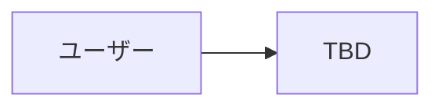

# 設計書

このプロダクトの唯一の設計書。**実装はこの設計書に準拠する。** 設計と違うことをしたくなったら、先にこの設計書を更新してから実装する。

設計書の前段階の議論は [docs/brainstorm/](brainstorm/README.md) に残す。決まったことだけをここに書く。

- ステータス：ドラフト
- 最終更新：2026-10-24

<!--
書き方のルール
- 決まったことだけを書く。未決のものは「13. 未決事項」に書く
- 各セクションの「TBD」を埋めていく
- 機密情報（APIキーの値、個人情報）は書かない。このリポジトリは public
-->

## 1. 概要

- **プロダクト名：** TBD
- **一言で：** TBD
- **○○ × Tech：** TBD（作品提出フォームにも書く項目）
- **テーマ：** 生成AI時代の研究の悩み解決

## 2. 背景と課題

### 想定ユーザー

TBD

### 解決する課題

<!-- 壁打ちで挙げた悩みのうち、今回解決するものだけを書く -->

TBD

### スコープ外

<!-- 今回はあえて解決しないもの。理由も書く -->

TBD

## 3. コンセプトと解決方法

<!-- 課題をどう解決するか。既存ツールとの違いもここに書く -->

TBD

## 4. 要件

### 機能要件

| ID | 機能 | 優先度 | 対応する課題 |
| --- | --- | --- | --- |
| F-1 | TBD | Must | |

<!-- 優先度：Must = デモに必須 / Should = 時間があれば / Could = Award Day に向けて -->

### 非機能要件

- APIキーはサーバー側だけで保持し、フロントエンドに含めない
- TBD

## 5. デモシナリオ

<!-- 審査で最重視されるのは「デモが動くこと」。発表で見せる流れを手順で書き、この流れが通しで動くことを最優先に実装する -->

1. TBD

## 6. システム構成

### 構成図

### 技術スタック

| 領域 | 採用技術 | 理由 |
| --- | --- | --- |
| フロントエンド | TBD | |
| バックエンド | TBD | |
| AI / LLM | TBD | |
| データベース | TBD | |
| デプロイ先 | TBD | |

## 7. 画面・UX

<!-- 主要な画面と、ユーザーの操作の順番 -->

TBD

## 8. データ設計

<!-- 扱うデータとその形 -->

TBD

## 9. API・インターフェース

<!-- フロントとバックの間、外部ツール（Claude Code / Codex など）との間のインターフェース -->

TBD

## 10. 外部サービスと環境変数

<!-- 環境変数は名前と用途だけを書く。値は .env に置き、絶対にここに書かない -->

| 環境変数 | 用途 |
| --- | --- |
| TBD | |

## 11. 開発計画

### 担当

| メンバー | 担当 |
| --- | --- |
| TBD | |

### マイルストーン

| いつ | 到達点 |
| --- | --- |
| Day1 19:10 中間発表 | TBD |
| Day2 15:00 Code Freeze | デモシナリオが通しで動く |
| Day2 15:30 | 作品提出フォームを提出 |
| 10/26(月) AM8:00 審査開始 | README（デモ動画リンク・作品情報）を main に反映済み |

## 12. 審査基準との対応

| 審査基準 | どう満たすか |
| --- | --- |
| 問題着眼点・着想点 | TBD |
| 実行・実現可能性 | TBD |
| 完成度・動作性 | TBD |
| プレゼンテーション力（Award Day） | TBD |

## 13. 未決事項

<!-- 決まったら該当セクションに移して、ここから消す -->

- [ ] TBD

## 変更履歴

| 日付 | 内容 |
| --- | --- |
| 2026-10-24 | 雛形を作成。テーマを記載 |
